# PowerTower

**A portable security workbench for one Windows machine — 22 tools in a single `exe`, no installer, no dependencies.**

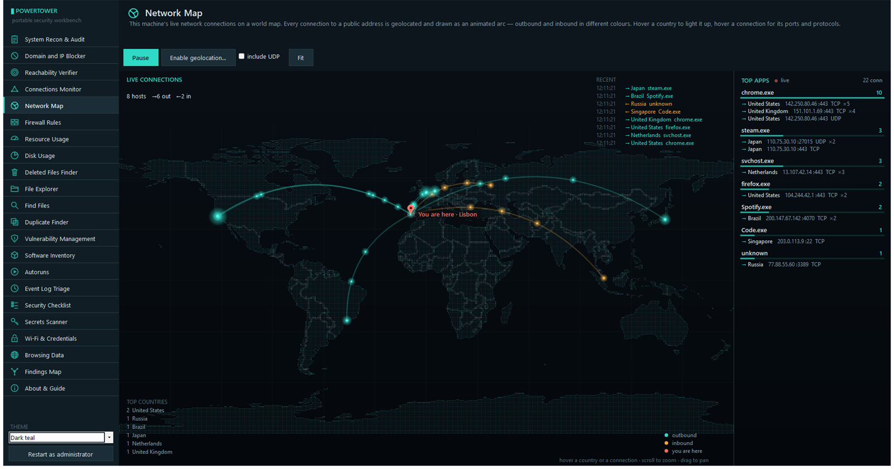

PowerTower audits, monitors and cleans up the machine it runs on: a read-only recon sweep and a scored hardening checklist, live connections on a world map, firewall and autorun review, event-log triage, vulnerability and software inventory checked against MSRC, NVD, CISA KEV and EPSS, deleted-file recovery, duplicate and secret scanning, and a browser and Wi-Fi credential audit. Every result is a table you can sort, search, filter, tick, act on and export.

It runs on the .NET Framework that is already part of Windows 10 and 11 and is compiled with the C# compiler that ships inside Windows — nothing to install, no packages, no runtime to download. Copy the folder anywhere (a USB stick works) and double-click `Toolbox\PowerTower.exe`.

> Every tool except the two maps is also a command: `Toolbox\PowerTowerCli.exe <tool>` gives the same names, columns, filters and CSV export from a terminal. See **Command line** below.

## Highlights

- **One window, one grammar.** Every tool renders into the same view — grid, details or tree. Type to search, click a header to sort, use the funnel on any column, stack filter rules (`Size at least 10 MB`, `Status does not contain blocked`), tick rows and act on them from the bar that appears, export CSV.
- **Read-mostly and reversible.** Nothing is installed, scheduled or left running. The few things that write — the hosts file, one named firewall rule, disabling an autorun, sending files to the Recycle Bin — are tagged, backed up or reversible, and say so before they act.
- **Honest about rights.** Tools that need administrator rights say so in their header; *Restart as administrator* relaunches elevated and comes back on the same tool.
- **Offline by default.** The only network traffic is opt-in and confirmed: the vulnerability feeds (MSRC, NVD, CISA KEV, EPSS) and IP geolocation for the map (ip-api.com), all cached on disk.
- **Secrets stay masked.** Wi-Fi keys, vault items, browser passwords and scanned secrets are hidden until you click *Reveal* and confirm. The optional NVD API key is stored DPAPI-encrypted.
- **Findings feed each other.** Connections and reachability results can be sent straight to the blocker; the Findings Map wires everything the tools found into one graph around the machine.
- **Four themes**, switched live from the sidebar — no restart.

## Themes

| Dark teal (default) | Hacker green |
|---|---|
| 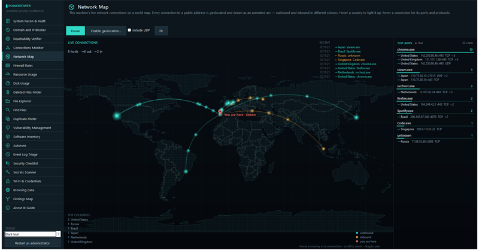 | 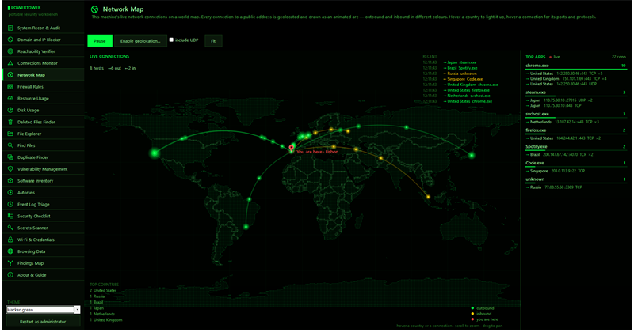 |
| **Red** | **Windows** |
| 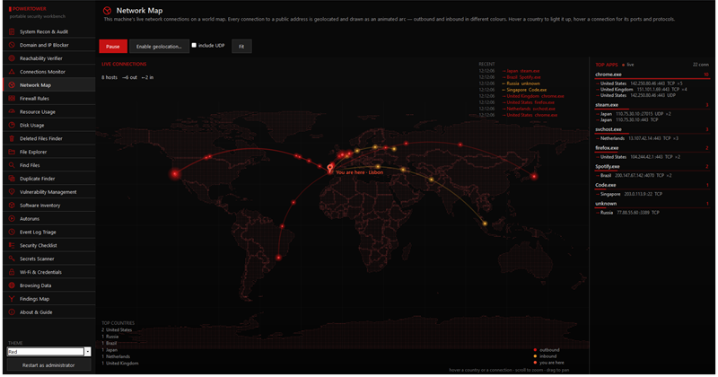 | 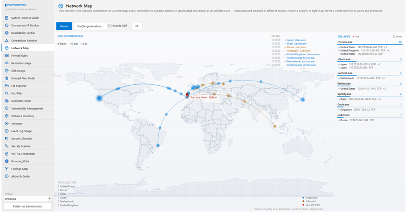 |

## The tools

### Recon & network

#### 🔍 System Recon & Audit

A read-only enumeration of the machine — system, users and groups, network, security posture, persistence surface, running processes and recent security events — with the risky settings flagged and a step strip while it runs. Save the whole report as Markdown, JSON or PDF.

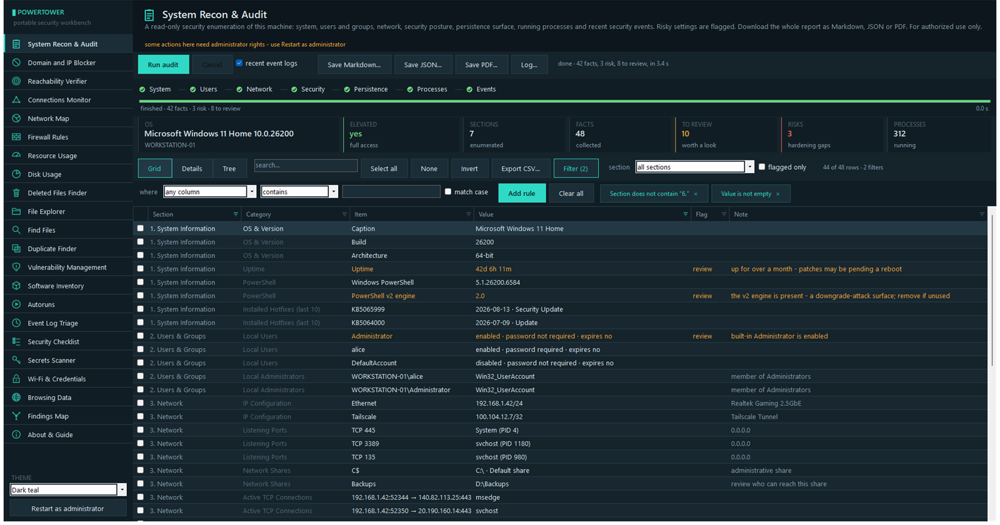

#### 🚫 Domain and IP Blocker

Load domains and IPs from any file or paste (URLs, log lines, CSV, defanged `evil[.]com` forms are all understood), review them as rows, and block or unblock the ones you pick. Domains go to the hosts file, IPs into one firewall rule; the hosts file is backed up before every change.

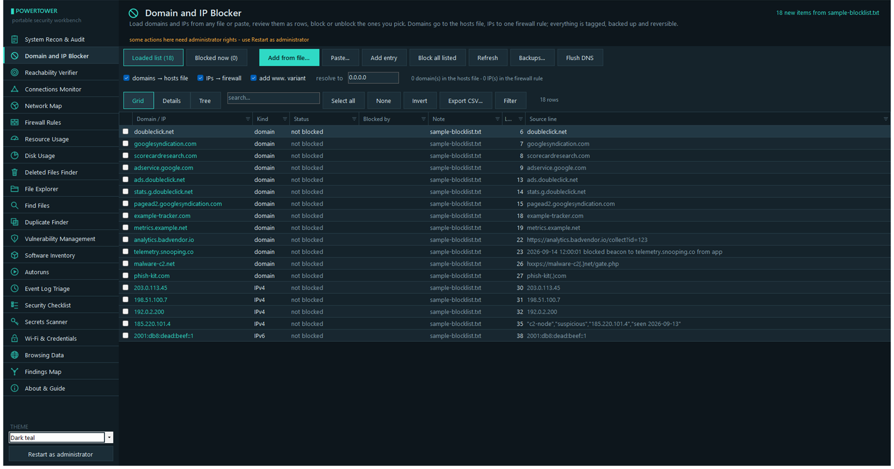

#### 📡 Reachability Verifier

For every target: DNS and what it resolves to, an optional ping, and a TCP connect to each port you list, with a timeout and parallelism you choose. Send the ones that answer straight to the blocker.

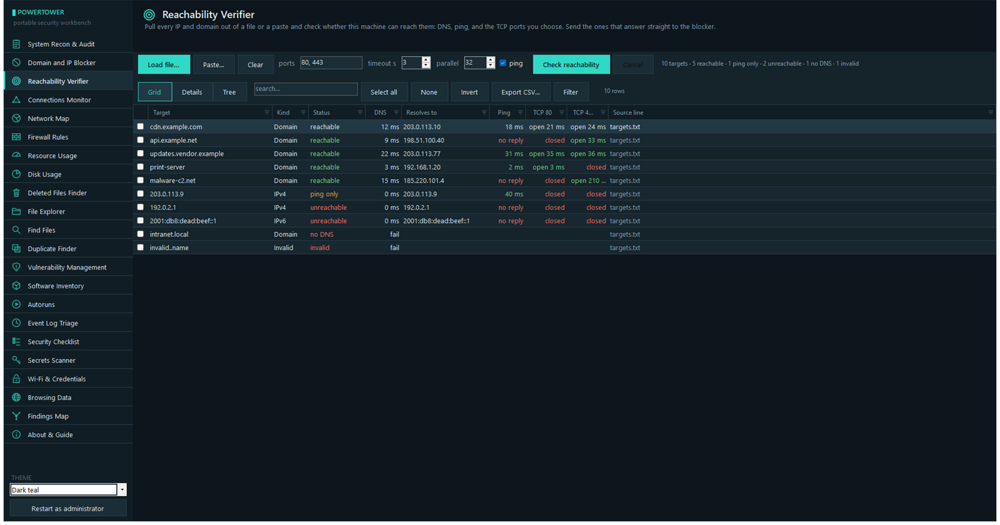

#### 🔗 Connections Monitor

Every TCP and UDP endpoint the machine has, refreshed each second: process, PID, addresses, state and remote host name. Closed connections linger greyed for a while so short-lived ones are not missed; block or copy the remote addresses in two clicks.

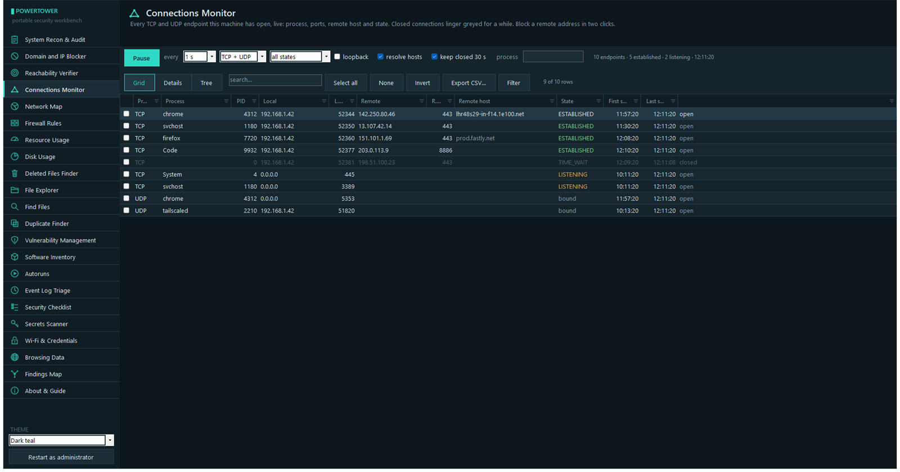

#### 🌍 Network Map

The live connections drawn on a world map, threat-map style. The world is a dense dot grid built from real country shapes embedded in the exe; hover a country to light it up, hover a connection for its ports, protocols and processes. Outbound and inbound arcs are coloured differently, a red pin marks *you are here*, and a sidebar ranks the apps behind the connections with country, destination, port and protocol in real time. Geolocation is opt-in.


#### 🧱 Firewall Rules

Every Windows Firewall rule as a sortable table, with the risky ones flagged — inbound Allow rules open to any address, rules that open all ports, rules not tied to a program — and whether the firewall is actually on for each profile.

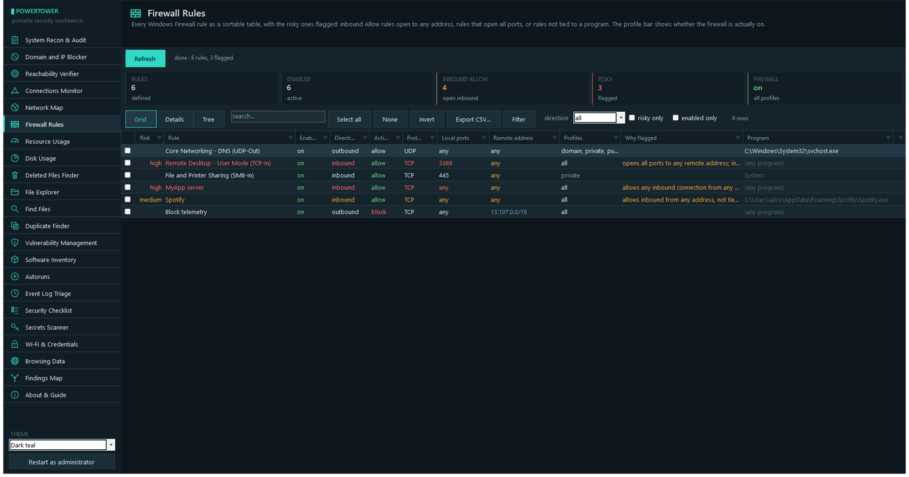

### Files & storage

#### 📈 Resource Usage

Which processes have used the most CPU time, memory and disk I/O since you opened the tool, not just right now, with gauges and per-process trend sparklines. Exited processes stay, greyed, because their totals still count. *Loaded modules…* lists a process's DLLs and flags the unsigned ones.

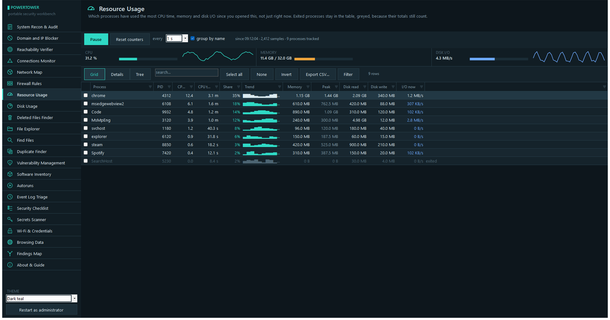

#### 💽 Disk Usage

Scan a drive or folder and see where the space went: the largest files, the biggest folders, the file types, and the folder tree with sizes. Open, copy or send the ones you pick to the Recycle Bin.

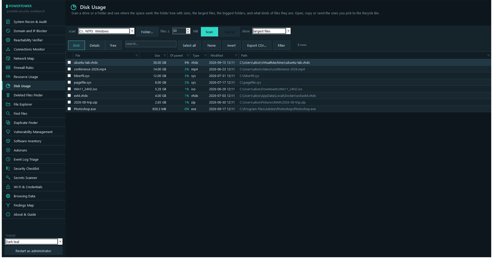

#### 🗑️ Deleted Files Finder

What was permanently deleted on each drive and whether it can come back: the NTFS change journal, the directory tables of exFAT externals read raw, shadow copies, and files emptied from the Recycle Bin. Recover the ones you pick to another drive.

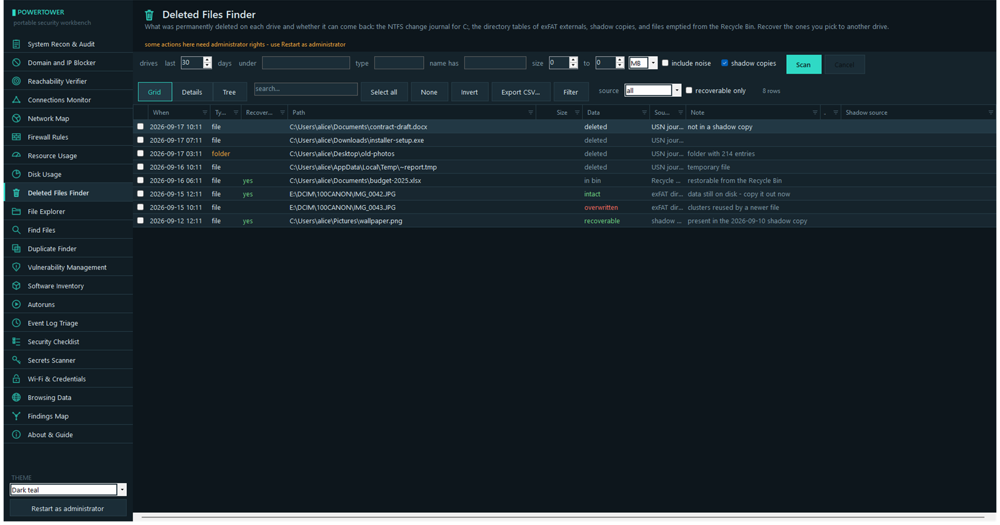

#### 📁 File Explorer

Browse the machine, pick files across folders, see each file's Authenticode signature, and act on the whole selection at once: AES-256 encrypt or decrypt, permanent delete, or a secure wipe.

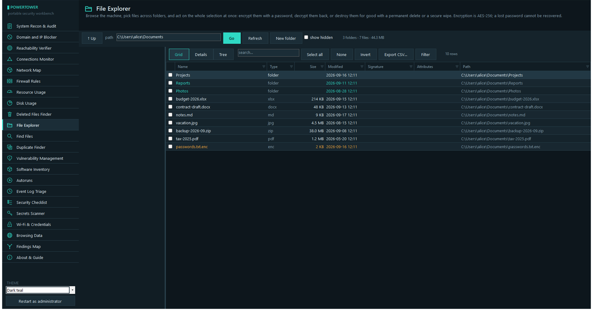

#### 🔎 Find Files

By name or wildcard, or by hash: paste any number of MD5, SHA-1 and SHA-256 hashes of mixed types — a plain list, a log line, JSON or a threat-intel report — or load them from a file, and every match is reported with its algorithm and path while a progress strip shows the walk.

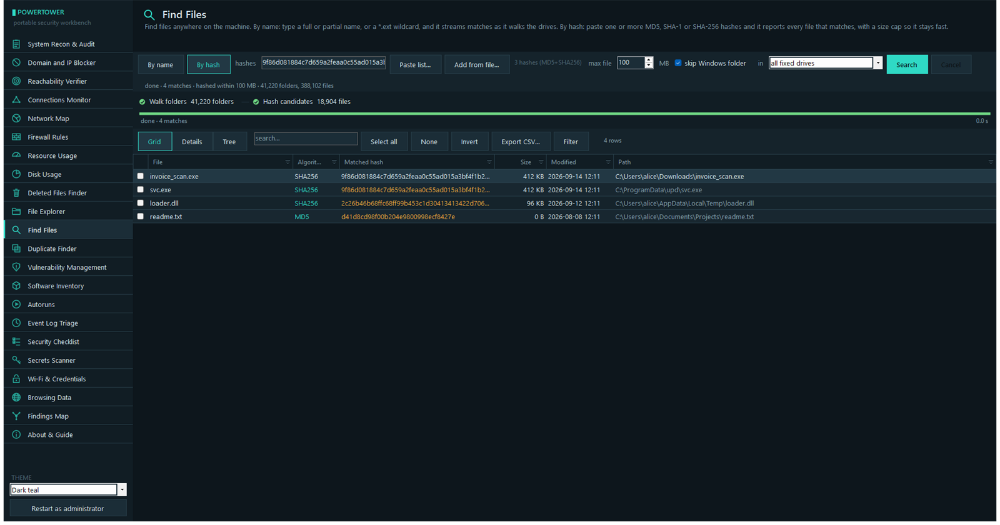

#### ♻️ Duplicate Finder

Files whose contents are identical, grouped with the space each group wastes. Size first, then a partial hash, then a full hash only where those still collide, so it is fast on large trees. Keep one copy, recycle the rest.

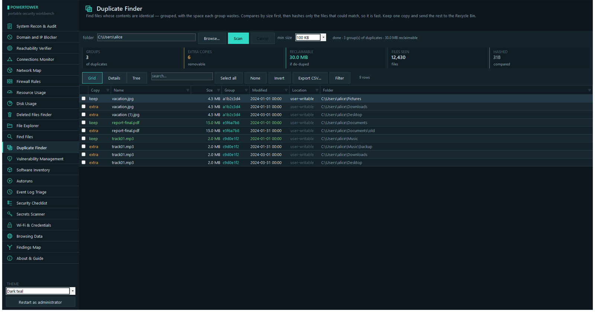

### Vulnerabilities & software

#### 🛡️ Vulnerability Management

Which CVEs this machine is exposed to and why: the OS build and hotfixes against Microsoft's monthly releases (build comparison first, KB supersedence second), installed software against the NVD, and what Windows Update is offering right now. CISA KEV and EPSS rank the findings; every one carries its evidence. Feeds are cached so a second scan is quick and an offline scan uses the last copy.

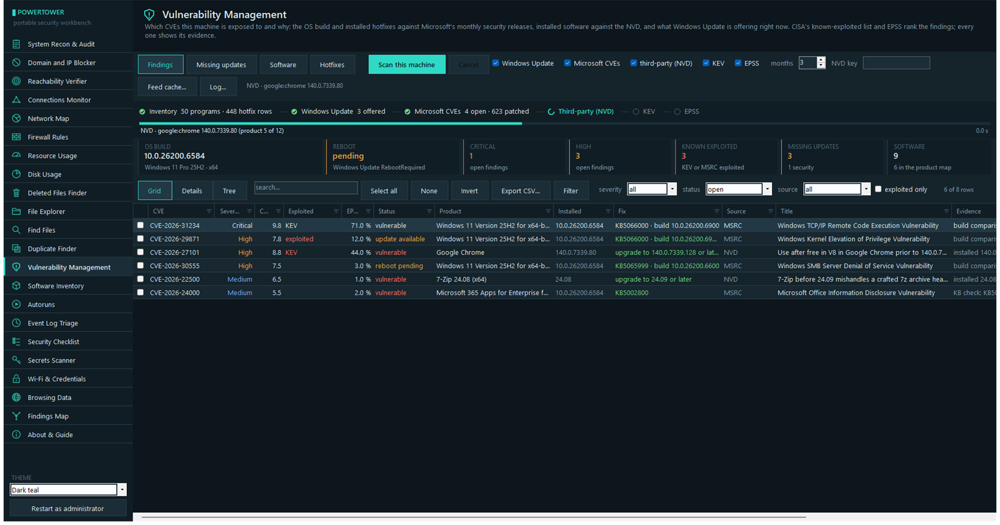

#### 📦 Software Inventory

Every installed program and its version, read from the uninstall hives (never `Win32_Product`), with the vulnerable ones highlighted by severity, worst CVE, known-exploited status, EPSS and the version to upgrade to. Filter by anything.

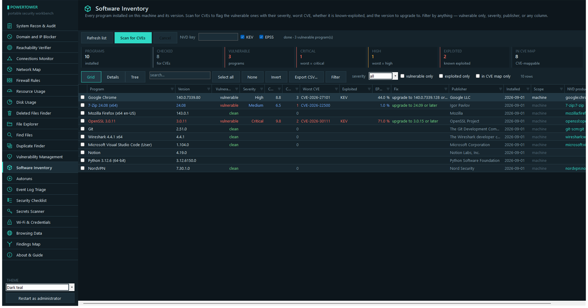

### Threat hunting & incident response

#### ▶️ Autoruns

Every place Windows starts a program on its own — run keys, startup folders, scheduled tasks, services, Winlogon, image hijacks, WMI subscriptions — with the program it runs, its signer and a risk flag. Disable, enable or delete entries.

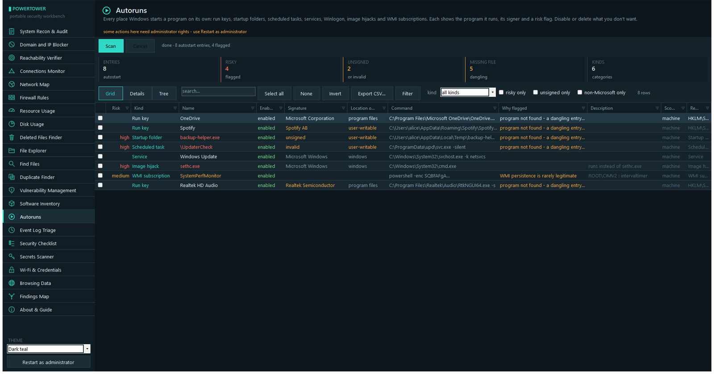

#### 📜 Event Log Triage

The event-log records that matter for an incident — failed and successful logons, new services and scheduled tasks, PowerShell script blocks, Defender detections, account changes, cleared logs — over a time range, parsed into account and detail fields and tinted by risk.

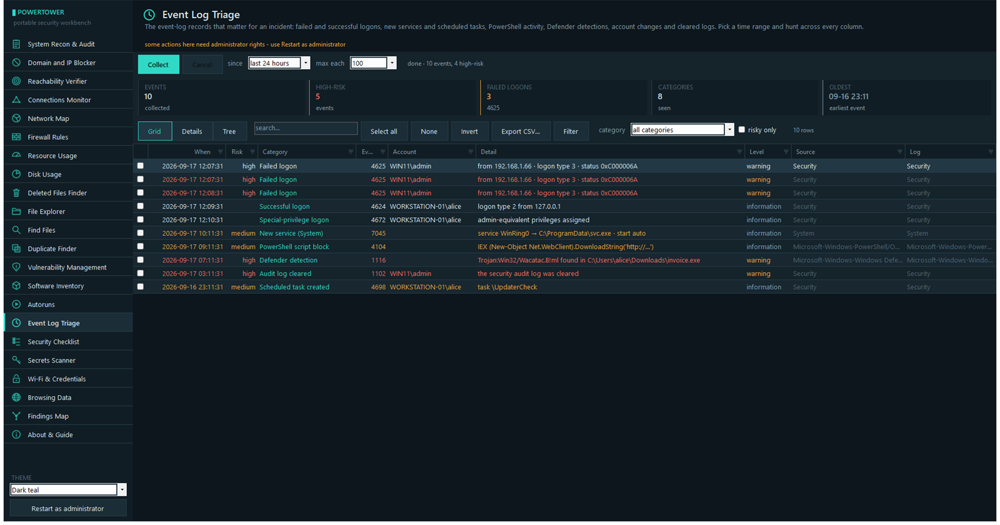

#### ✅ Security Checklist

A pass-or-fail review of the common endpoint audit items scored out of 100 — accounts, disk encryption, antivirus and EDR, remote access and VPN tools, USB control, firewall, pending reboot — each with its evidence. *Active tests* (a separate button, because it drops a file on purpose) writes the EICAR test file and checks that real-time protection removes it, and reads the application-control policy.

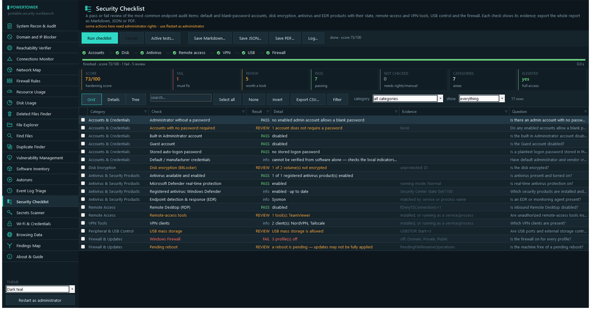

### Secrets & credentials

#### 🔑 Secrets Scanner

Walk a folder or drive for exposed secrets — private keys, cloud API keys, tokens, connection-string and generic passwords in `.env` and config files. Each hit shows the file, line and a masked preview; the whole secret is never put on screen.

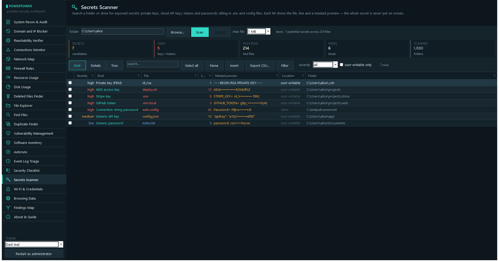

#### 📶 Wi-Fi & Credentials

The secrets saved on this machine: Wi-Fi networks with their security type (open, WEP and legacy WPA flagged) and their stored key, plus the Windows Credential Manager vault. Revealing anything is opt-in and confirmed.

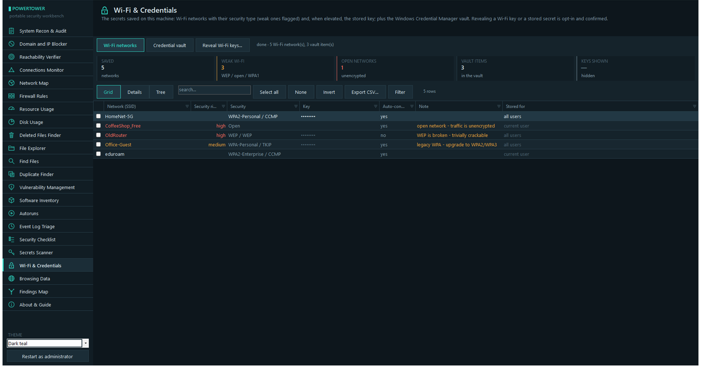

#### 🌐 Browsing Data

History, downloads, searches and saved passwords from every browser on the machine — Chrome, Edge, Brave, Vivaldi, Opera and Firefox, including the Microsoft Store build — read straight from their databases by a dependency-free SQLite reader written for this app. The Domains view ranks every site by visits; passwords stay masked until revealed.

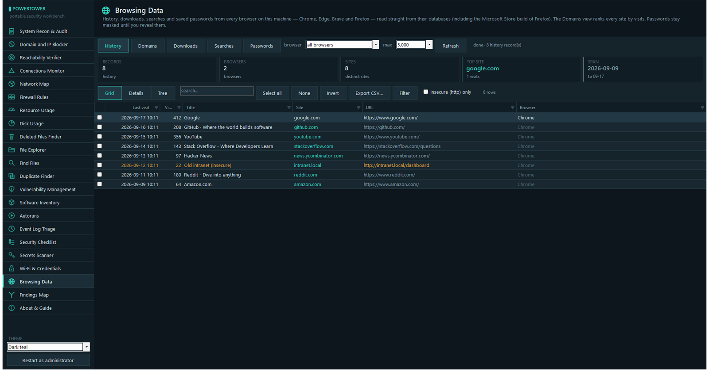

### Putting it together

#### 🕸️ Findings Map

The machine at the centre of a live force-directed graph, wired to everything the tools found: users, network, software, autoruns, firewall, Wi-Fi, browsers, the checklist and any vulnerabilities. Drag a node and it stays where you drop it, right-click to release it, *Reformat* to re-flow, scroll to zoom. Red branches show where to look first.

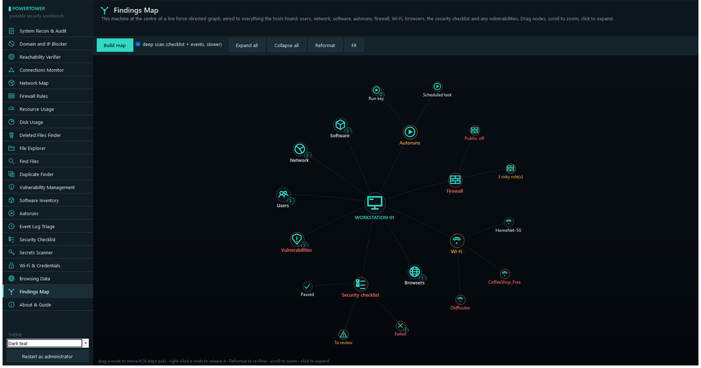

#### ℹ️ About & Guide

What each tool does, grouped by job; click any entry to open it.

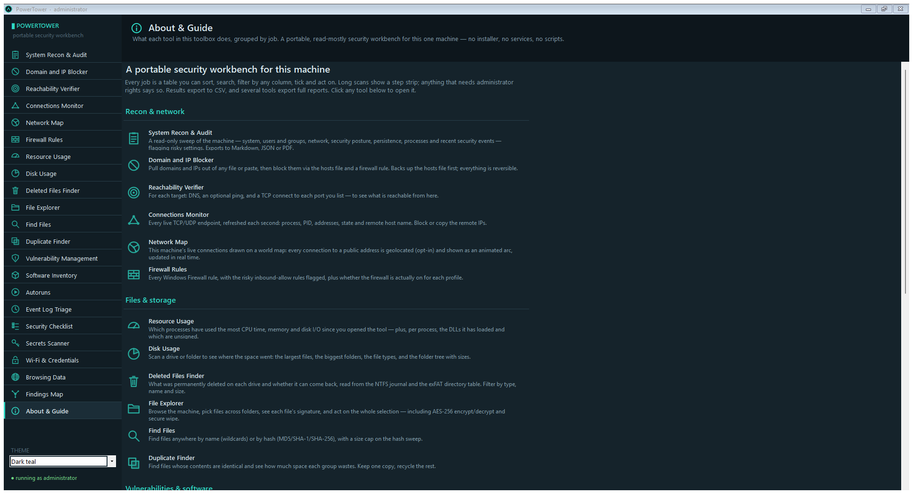

## Getting started

1. Copy the repository folder anywhere. Windows 10 or 11 with .NET Framework 4.8 (part of Windows) is all it needs.
2. Run `Toolbox\PowerTower.exe`. Tools that need more rights say so; *Restart as administrator* is in the sidebar.
3. Settings live in `Toolbox\settings.ini` next to the exe (delete it to reset); downloaded feeds and the geolocation cache in `Toolbox\cache\`.

Command-line flags: `--tool <PanelClassName>` opens on a tool, `--theme "<name>"` overrides the saved theme for one run, `--selftest report.txt` exercises every panel against real data and writes a report, `--shots <folder> --demo` captures a screenshot of every panel using synthetic data only.

## Build from source

```
cd Toolbox
build.cmd      builds PowerTower.exe, PowerTowerCli.exe and Tests.exe with %WINDIR%\Microsoft.NET\Framework64\v4.0.30319\csc.exe
Tests.exe      runs the engine tests; the exit code is the number of failures
```

C# 5 on .NET Framework 4.8, WinForms, zero external libraries: the SQLite reader, the PDF writer, the JSON reader, the exFAT and USN-journal readers, the Authenticode and catalog verification, the country-shape map and the force-directed graph are all in the sources. No SDK or Visual Studio is required.

## Command line

`Toolbox\PowerTowerCli.exe` is the same workbench for a terminal: the same tools in the same order, the same
columns, and the app's view bar as options. If you know one, you know the other.

```
PowerTowerCli                          the tools, grouped like the sidebar (in a terminal, drops into the console)
PowerTowerCli console                  interactive console — a Metasploit-style shell over the same tools
PowerTowerCli <tool> --help            options, actions and columns of one tool
PowerTowerCli firewall --risky
PowerTowerCli autoruns --non-microsoft --view tree
PowerTowerCli deleted-files --drives E --type jpg,mp4 --recoverable --csv lost.csv
PowerTowerCli software --scan --where "cves greater than 0" --sort sev --desc
PowerTowerCli blocker --file threats.txt --select "kind equals domain" --block
```

### Interactive console

`PowerTowerCli console` (or just `PowerTowerCli` in a terminal) opens a Metasploit-style shell. Each tool is a
*module*: `use` one, `set` its options, `run` it. Every run prints the equivalent one-shot line, so the console
is also a way to learn the flags. Piped or redirected, the bare command still prints the plain tool list, so
scripts are unaffected.

```
show tools            every module, grouped and numbered
search <text>         modules whose name or description match
use <module|#>        select a module (e.g. use recon, or use 1)
info                  the module's full help: options, columns, examples
options               the module's options and the values you have set
set <opt> <value>     set an option (set path D:\Photos, set view tree)
unset <opt|all>       clear an option
run                   run the module with the options set (also: exploit)
back · banner · help · exit
```

| in the app | on the command line |
|---|---|
| Grid / Details / Tree | `--view grid`, `--view details`, `--view tree` |
| search box | `--search <text>` |
| click a column header | `--sort <column>`, `--desc` |
| Filter rules (13 operators, units understood) | `--where "<column> <operator> <value>"`, repeatable, AND |
| tick rows / Select all | `--select "<column> <operator> <value>"` / `--all` |
| the action bar under the rows | the tool's action flags, applied to the ticked rows |
| Yes in a confirmation | `--yes` |
| Export CSV… | `--csv <file>` — a bare filename lands in a `reports\` folder next to the exe; pass a path to write elsewhere |

Tables go to stdout, progress to stderr; settings and the feed cache are shared with the app. The full
tool-by-tool reference is in [`Toolbox/README.md`](Toolbox/README.md#command-line-powertowercliexe).

## Safety notes

- **Authorized use only.** Run it on machines you own or are allowed to audit. It reads saved credentials and browser data on request; that is the point of the audit, and it is also why every reveal asks first.
- **Antivirus.** Only the checklist's *Active tests* button touches disk with something an antivirus should react to (the EICAR test file, assembled in memory). Expect an alert from that test and nothing else.
- **Browser passwords.** Chromium entries protected by app-bound encryption (recent Chrome and Edge) cannot be decrypted by any external tool; they are counted and reported as such rather than guessed at.
- **Screenshots.** Every image on this page was captured in demo mode (`--shots --demo`), which never reads the real machine: the host names, users, addresses, hashes and secrets in them are synthetic.

## Repository layout

```
Toolbox\                            sources, build.cmd, PowerTower.exe (the app), PowerTowerCli.exe (the command line), Tests.exe
Toolbox\README.md                   tool-by-tool reference — every column, action and flag, for the app and the command line
Toolbox\samples\                    sample input files for the blocker and the reachability verifier
docs\screenshots\                   the images on this page
```
