# PowerTower — tool reference

> The overview with screenshots is the [repository README](../README.md); this page is the tool-by-tool reference.

A portable Windows security workbench: twenty-two tools as rows you can sort, search, tick and act
on, in one desktop app and, for everything that is not a map, as one command-line suite with the same
names, columns and grammar. No installer: both run on the .NET Framework that is already part of
Windows 10 and 11. Copy the whole `PowerTower` folder anywhere and double-click `Toolbox\PowerTower.exe`,
or open a prompt in `Toolbox\` and run `PowerTowerCli <tool>`.

**One set of engines, one set of columns.** `Net.cs`, `Sys.cs`, `Vuln.cs` and the other engine files do
the work; `Columns.cs` defines every table once; the app renders it in a grid and the command line in the
console. A column added there appears in both, with the same header, and in the CSV either one exports.

```
┌ sidebar ─────────────┐┌ Vulnerability Management ────────────────────────────────────────────────┐
│ Domain and IP Blocker││ [Findings][Missing updates][Software][Hotfixes]  [Scan this machine][Cancel]│
│ Reachability Verifier││ [x] Windows Update [x] Microsoft CVEs [x] third-party (NVD) [x] KEV [x] EPSS │
│ Connections Monitor  ││ ┌OS BUILD────────┐┌REBOOT──┐┌CRITICAL┐┌HIGH┐┌KNOWN EXPLOITED┐┌MISSING┐┌SOFTWARE┐│
│ Resource Usage       ││ │10.0.26200.6584 ││pending ││   1    ││ 3  ││      2        ││   3   ││ 50/12  ││
│ Disk Usage           ││ └────────────────┘└────────┘└────────┘└────┘└───────────────┘└───────┘└────────┘│
│ Deleted Files Finder ││ [Grid][Details][Tree] [search…] [Select all][None][Invert][Export CSV…] filters │
│ Vulnerability Mgmt   ││ [ ] CVE-2026-31234  Critical 9.8  KEV   vulnerable  Windows 11 25H2 …  KB5066000│
│                      ││ [x] CVE-2026-27101  High     8.8        vulnerable  Google Chrome   …  upgrade… │
│ [Restart as admin]   ││ 2 findings selected  [Copy CVE IDs][Open advisories][Copy as text][Export…]     │
└──────────────────────┘└────────────────────────────────────────────────────────────────────────────┘
```

---

## What it is - and what it is not

**It is**

- **Twenty-two tools, one window.** Every tool has its own icon in the sidebar; **About & Guide** lists them all. Audit the system, block domains and IPs, verify reachability, watch
  live connections, monitor resource usage, analyze disk usage, find deleted files, browse and act on
  files, find files by name or hash, manage vulnerabilities, inventory software and its CVEs, run a security checklist, map the findings.
- **Rows, not text.** Every tool shows its results in the same view: a **grid**, a **details** pane
  (the row plus every property), or a **tree** (grouped: by kind, by folder, by source). Type to
  search, click a header to sort, tick rows (shift-click for a range, `Space` toggles, `Ctrl+A`
  selects all, `Ctrl+C` copies), then act on the ticked rows from the bar that appears at the bottom.
- **Filters on every column.** *Filter* opens a rule bar: pick a column (or *any column*), an
  operator - *contains*, *does not contain*, *equals*, *does not equal*, *starts with*, *ends with*,
  *matches regex*, *is empty*, *is not empty*, *greater than*, *less than*, *at least*, *at most* -
  and a value. Rules stack as chips (click one to remove it) and combine with AND; the number
  operators understand units, so `Size at least 10 MB` and `DNS less than 50` work on the values you
  see. Or click the small **funnel** in any column header to filter that column from a checklist of
  its distinct values (with counts) or a contains box; the funnel turns teal when that column is
  filtered. Right-click any cell for the quick versions: filter on that value, exclude it, copy the
  cell, the row, or the whole column.
- **Visible progress.** Long scans (the audit, the vulnerability scan) show a step strip: each stage
  with its state and result count, a progress line, the current action and the elapsed time.
- **Editable where it makes sense.** In the blocker a value can be retyped in its row and is
  re-classified as a domain, IPv4 or IPv6 on the spot.
- **Exportable.** *Export CSV…* on every view writes what is shown, or only the ticked rows.
- **Portable and reversible.** Settings live in `settings.ini` next to the exe; downloaded feeds in
  `cache\`. The hosts file is backed up before every change; IPs go into one named firewall rule.
- **Themes.** Pick one in the sidebar footer and the whole app re-tints in place, no restart: **Dark teal**
  (default), **Hacker green** (phosphor green on black), **Red**, or **Windows** (light mica grey, white cards,
  Windows-blue accent — including a light, paper-style network map). The choice is remembered in `settings.ini`;
  `--theme <name>` overrides it for one run.
- **Honest about rights.** Tools that need administrator rights say so in the header; *Restart as
  administrator* relaunches elevated and comes back on the same tool.

**It is not**

- **Not a script runner.** Nothing is executed through `powershell.exe`; the app and the command
  line have their own engines, compiled from the same sources.
- **Not an installer of anything.** No service, no scheduled task, no registry settings outside
  the hosts file and firewall rule you ask for.
- **Not a remote tool.** Everything is about this machine. The vulnerability feeds are the only
  network traffic, all of it outbound to public APIs, and each can be switched off.

---

## The tools

### 1 · 🚫 Domain and IP Blocker

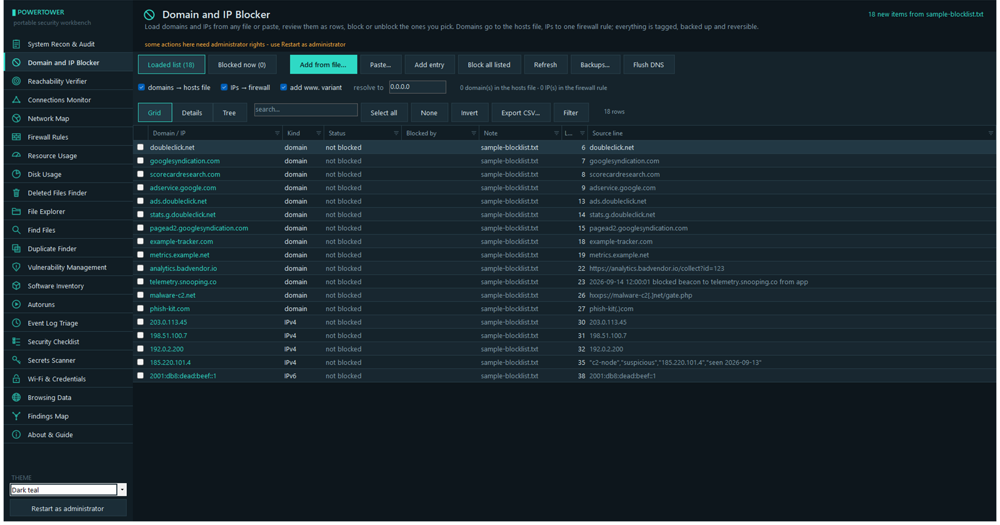

Load domains and IPs from any file (*Add from file…*), a paste (*Paste…*) or by typing (*Add entry*).
The extractor pulls hosts out of URLs, log lines, CSV cells, prose and defanged forms
(`evil[.]com`, `hxxps://`), keeps the source line number, and drops file names that look like
domains (`setup.ps1`, `notes.md`).

| Column | Meaning |
|---|---|
| Domain / IP | the value; editable in place |
| Kind | domain · IPv4 · IPv6 · invalid |
| Status | blocked · not blocked · not a valid domain or IP |
| Blocked by | hosts file · firewall · both |
| Line · Source line | where it came from |

*Block selected* writes domains to the hosts file (tagged `# BLOCK-HOSTS`, resolving to the
address in *resolve to*, with a `www.` twin when ticked) and IPs to the firewall rule
`BLOCK-HOSTS blocked IPs`. *Unblock selected* removes them. **Blocked now** switches the rows to what
is currently in the hosts file and the rule, so anything can be unblocked later. *Backups…* lists
the hosts-file backups (`%ProgramData%\BlockHosts\backups`) and restores one; *Flush DNS* runs
`ipconfig /flushdns`. Writing needs administrator rights; listing does not.

### 2 · 📡 Reachability Verifier

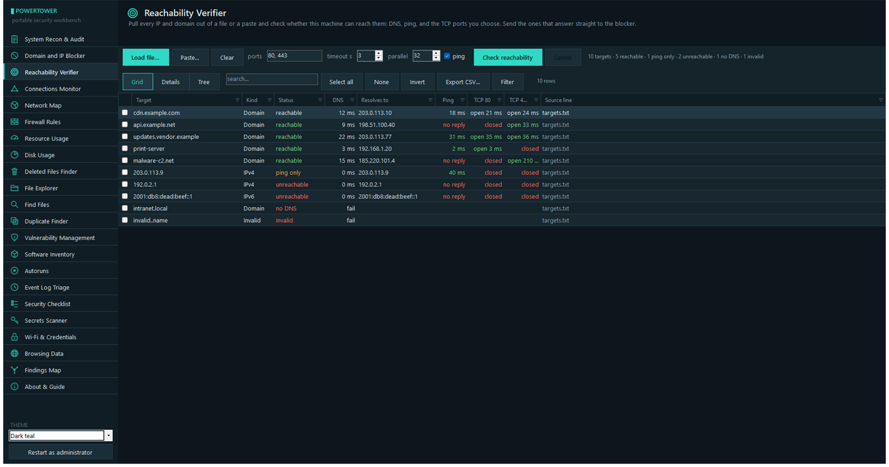

Same loaders. For every target: DNS (and what it resolves to), an optional ping, and a TCP connect
to each port you list (`443, 80, 8443`), with a timeout and a parallelism you choose. Status is
**reachable**, **ping only**, **resolves**, **unreachable** or **no DNS**; each port gets its own
column with the connect time. *Send to blocker* hands the ticked rows to tool 1.

### 3 · 🔗 Connections Monitor

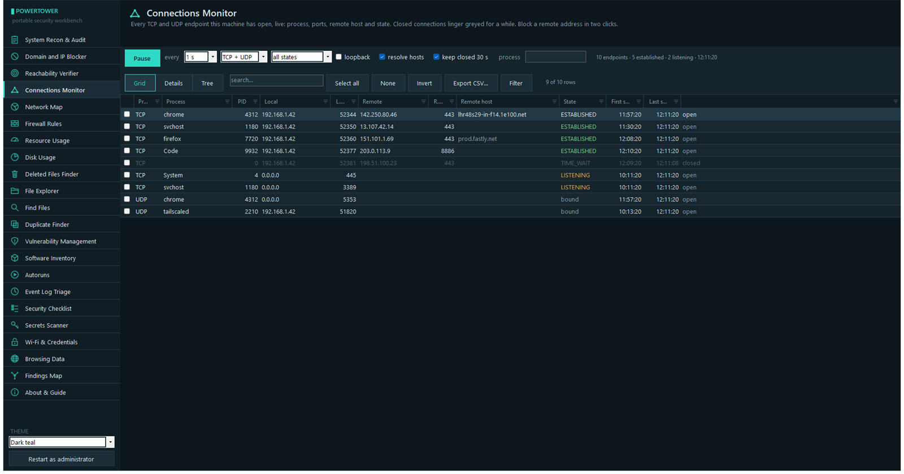

Every TCP and UDP endpoint (v4 and v6) the machine has, refreshed every second: protocol, process,
PID, local and remote address and port, state, remote host name (reverse DNS in the background),
first and last seen. Filters for protocol, state, loopback and process; closed connections linger
greyed for 30 s so short-lived ones are not missed. *Pause* freezes the table. *Block remote IPs*
sends the ticked rows' addresses to the blocker; *Copy remote IPs* puts them on the clipboard.

### 4 · 📈 Resource Usage

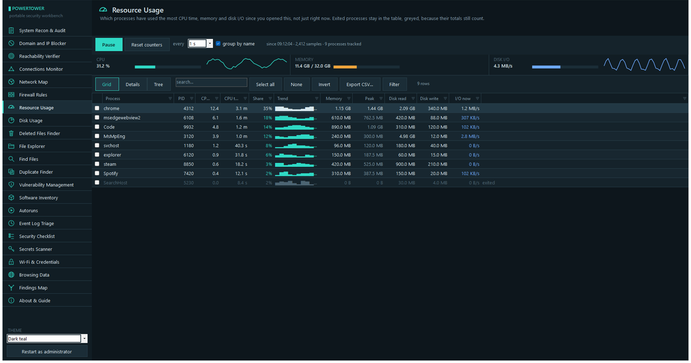

Three gauges (CPU, memory, disk I/O) with sparklines, and one row per process (or per process
name when *group by name* is ticked): CPU %, CPU time since you opened the tool, share of all CPU
time, a trend sparkline, memory and its peak, bytes read and written. Exited processes stay,
greyed, because what they used still counts. *Reset counters* starts the accounting again.
*End selected processes…* asks first.

### 5 · 💽 Disk Usage

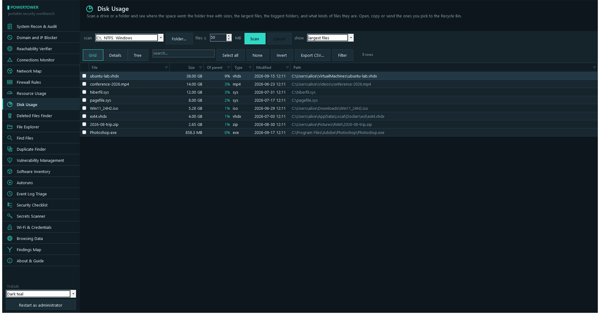

Pick a drive or a folder and a minimum file size, then *Scan*. **Show** switches between the
largest files, the biggest folders and the file types; the **tree** view is the folder tree with
sizes and each folder's share of its parent. Actions on ticked rows: *Open in Explorer*, *Copy
paths*, *Move to Recycle Bin…* (asks first; the bin, so it is reversible).

### 6 · 🗑️ Deleted Files Finder

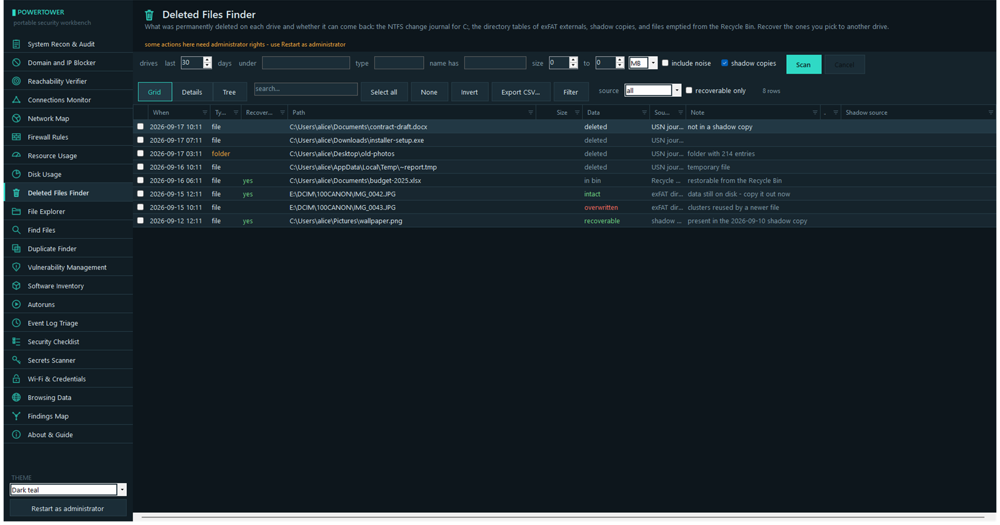

What was deleted on each drive in the last *n* days and whether it can come back. Sources: the NTFS
change journal (needs administrator rights), the directory tables of exFAT drives read raw (no
rights needed; works on external SSDs), shadow copies that still hold the file, and sets of files
emptied from the Recycle Bin (shown as cards with the deletion time). Filters for source and
*recoverable only*; a path filter; *include noise* shows temp and cache files too. Narrow the scan up
front by **type** (extensions), **name has** (a substring) and a **size** range with a KB/MB/GB unit, and
watch a per-drive step strip while it runs. *Recover selected to…* copies the ticked rows to another
drive (never the same one, so nothing is overwritten). "Recoverable" is "yes" only for exFAT files whose
data is still intact, or NTFS files still held in a shadow copy; the change journal records the deletion,
not the data.

### 7 · 📁 File Explorer

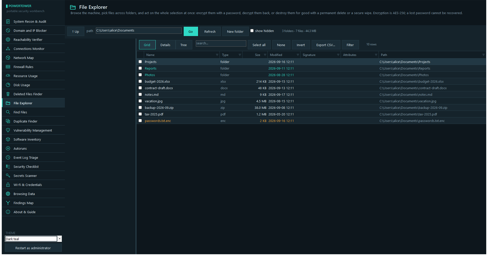

A two-pane browser: a folder tree on the left, the current folder's files on the right, with a path
box, *Up*, *Refresh*, *New folder* and *show hidden*. The file list is the same view as everywhere
else, so you can search, sort, filter and multi-select across it. Folders show teal, encrypted `.enc`
files show amber. The actions on the ticked files:

- **Encrypt…** — AES-256 with a password you set. Each file is written to a new `.enc`, verified that
  it decrypts, and only then the original is permanently deleted. **A lost password cannot be
  recovered** — the key is derived from the password alone (PBKDF2, 200k iterations), and the file is
  authenticated with HMAC-SHA256 so a wrong password or a corrupted file is rejected, not mis-decrypted.
- **Decrypt…** — the reverse, with the same password. The decrypted file is written next to the `.enc`,
  which is kept. A wrong password stops before writing anything.
- **Permanent delete…** — bypasses the Recycle Bin. Not recoverable. Asks first, showing the count and
  total size.
- **Secure wipe…** — overwrites each file with random data, then a zero pass, then deletes it. Asks
  twice. On SSDs, wear-levelling means it defeats casual recovery, not forensic recovery.

### 8 · 🔎 Find Files

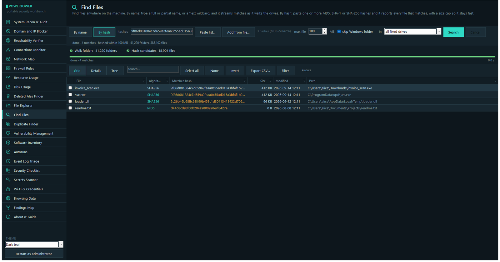

One panel, two modes.

- **By name** — type a full or partial name, or a `*.ext` / `data????.csv` wildcard, pick a drive or
  *all fixed drives*, and it walks the tree on several threads, streaming matches as they turn up.
- **By hash** — paste one or more MD5, SHA-1 or SHA-256 hashes (an IOC list, one per line, `#` comments
  ignored) and it reports every file whose hash matches, with the algorithm and path. A **max file
  size** cap (default 100 MB) and a *skip Windows folder* toggle keep it fast; both are adjustable.

*Open location*, *Copy paths* and *Export results* act on the selection. Results stream in live with a
running count of folders scanned.

The **hash** box takes **many hashes of mixed types at once** — paste a plain list, a log line, JSON or a
threat-intel report and every MD5, SHA-1 and SHA-256 in it is pulled out by regex wherever it sits (a 64-char
SHA-256 is never mis-split into shorter hashes); **Add from file…** loads them straight from a file. Both
name and hash searches show a **live progress strip**: folders walked, files seen, matches so far and the file
being read, with the elapsed time.

### 9 · 🛡️ Vulnerability Management

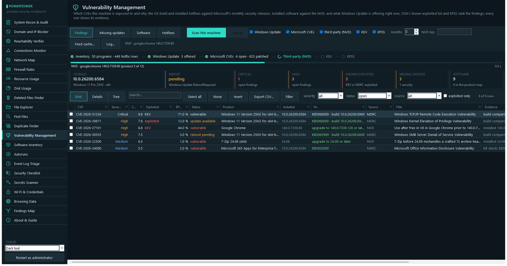

The goal of the *patchproof* project, for this machine, offline-capable:

| Step | Source | What it produces |
|---|---|---|
| Inventory | registry, `Win32_QuickFixEngineering`, the CBS servicing store, Windows Update history | OS build with UBR, installed hotfixes and the set of known KBs, pending-reboot signals, installed software (64-bit, 32-bit and per-user uninstall hives; never `Win32_Product`) |
| Windows Update | `Microsoft.Update.Session` | the updates offered to this machine right now, with severity, kind, size and the CVEs each one fixes |
| Microsoft CVEs | MSRC CVRF monthly releases (public API) | one finding per applicable CVE: **build comparison** (host UBR ≥ the fix's FixedBuild → patched) first, **KB + supersedence graph** for products without a FixedBuild (Office, .NET…), **reboot pending** when the KB is installed but the running build has not moved |
| Third-party | NVD 2.0, per installed program in the product map (7-Zip, Chrome, Firefox, Git, VLC, Wireshark, Nmap, Edge, VS Code, Notepad++, PuTTY, WinRAR, Node.js, VirtualBox …) | findings only where the installed version falls inside a vulnerable range or matches exactly; NVD entries with no version bounds are listed as *unconfirmed*, never as vulnerable |
| Priority | CISA KEV, EPSS | *Exploited* column (KEV, ransomware, or Microsoft's own "Exploited: Yes"), EPSS probability, and the sort order: open findings first, exploited first among them, then severity and CVSS |

Every finding carries its **evidence** (`build comparison: host 10.0.26200.6584 < fixed
10.0.26200.6900 (KB5066000) → not patched`, `installed 24.08 vs 7-zip:7-zip: ✓ < 24.09`). Four row
sets share the view: **Findings** (filters: severity, status, source, exploited only), **Missing
updates**, **Software** (with *Look up CVEs for selected* to query the NVD for just those programs),
**Hotfixes** (QFE, CBS and Windows Update history side by side). Actions: *Copy CVE IDs*, *Open
advisories*, *Copy as text*, *Send fix KBs to clipboard*, *Copy KBs*, *Open Windows Update*,
*Export CSV…*. Double-click a row to open its advisory.

Feeds are cached in `cache\` (the MSRC month is about 15 MB; KEV 2 MB; NVD answers are small) so a
second scan is quick and an offline scan uses the last copy. *Feed cache…* shows and clears them;
*Log…* shows every step and any problem. The NVD allows 5 requests per 30 s without a key, so a
scan with ten mapped programs waits about a minute on that step; a free key
(nvd.nist.gov/developers/request-an-api-key) in the *NVD key* box makes it near-instant. *months*
is how many monthly Microsoft releases to check; a machine that has not been updated for a year
needs 12.

No administrator rights are needed for any of this.

### 10 · 📦 Software Inventory

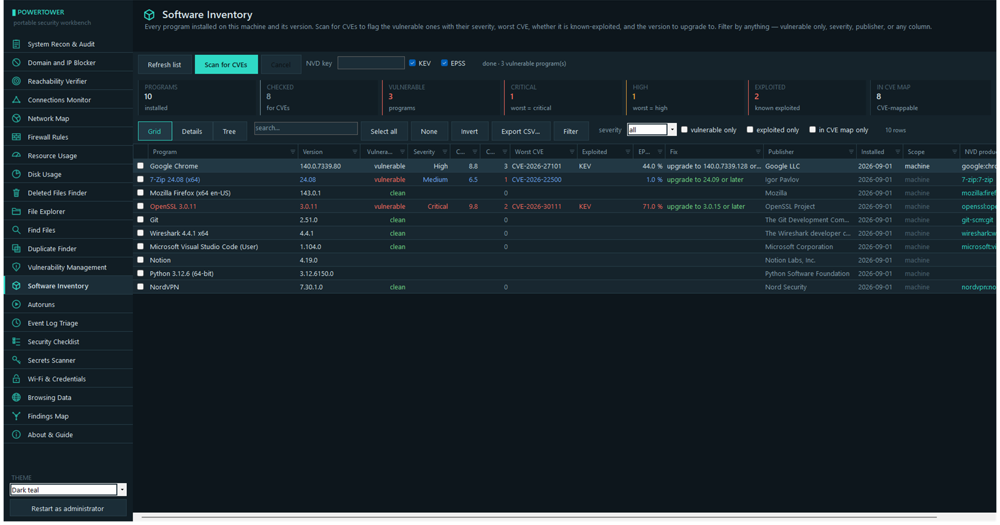

Every program installed on this machine — name, version, publisher, install date, scope — read from the
uninstall registry hives (64-bit, 32-bit and per-user), never `Win32_Product`. *Scan for CVEs* then looks
up each program that is in the CVE product map against the NVD at its exact version and flags the
vulnerable ones: the row is tinted by severity, with the **worst CVE**, its **CVSS**, whether it is
**known-exploited** (CISA KEV), its **EPSS** probability, and the **version to upgrade to**. Summary cards
count the vulnerable, critical, high and exploited programs.

The filtering is the advanced kind: the shared **column-header funnels** and the **Filter** rule bar work
on every column, plus dedicated *vulnerable only*, *exploited only*, *severity* and *in CVE map only*
toggles. Actions: *Scan selected* (look up just the ticked programs), *Copy CVE list*, *Copy names +
versions*, *Open on NVD*, *Export*. It shares the NVD key and the feed cache with Vulnerability Management,
so if you scanned there already, this is instant.

### 11 · ✅ Security Checklist

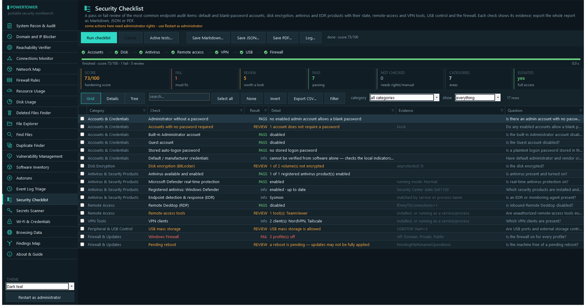

A pass or fail review of the most common endpoint audit items, scored out of 100, each check showing
its evidence. It covers:

| Area | Checks |
|---|---|
| Accounts & credentials | admin account with no password required, any blank-password account, built-in Administrator and Guest state, a stored auto-logon password. A *default / manufacturer credentials* note explains what an endpoint scan can and cannot prove. |
| Disk encryption | BitLocker protection per volume (needs administrator rights). |
| Antivirus & security products | antivirus present and enabled, Defender real-time protection and running mode (active vs passive), every product registered with the Windows Security Center with its enabled / up-to-date state, and known EDR or monitoring agents by service and process name. |
| Remote access | inbound Remote Desktop, and remote-access tools (TeamViewer, AnyDesk, VNC, RustDesk, ScreenConnect, Splashtop, LogMeIn …) found installed or running. |
| VPN | VPN clients (NordVPN, Tailscale, OpenVPN, WireGuard, AnyConnect, GlobalProtect …). |
| Peripheral & USB control | whether USB mass storage and removable drives are blocked by policy. |
| Firewall & updates | firewall on for every profile, and whether a reboot is pending. |

**Active tests** (a separate button, because they drop test files on purpose): the **EICAR** anti-malware
test writes the standard harmless test file and checks that real-time antivirus removes it (the EICAR
string is built in memory so the app itself is never quarantined); the **application-control** check reads the
AppLocker / SRP / WDAC / SmartScreen policy from the registry and reports whether execution is controlled
— it does not run or drop anything. Only the EICAR file touches disk; expect your antivirus to alert on it.

Filter by category or by result, *Copy as text* the ticked checks, and *Save Markdown / JSON / PDF*
for the whole report. Without administrator rights, BitLocker and a few reads report *N/A* rather than
failing.

### 12 · 🧱 Firewall Rules

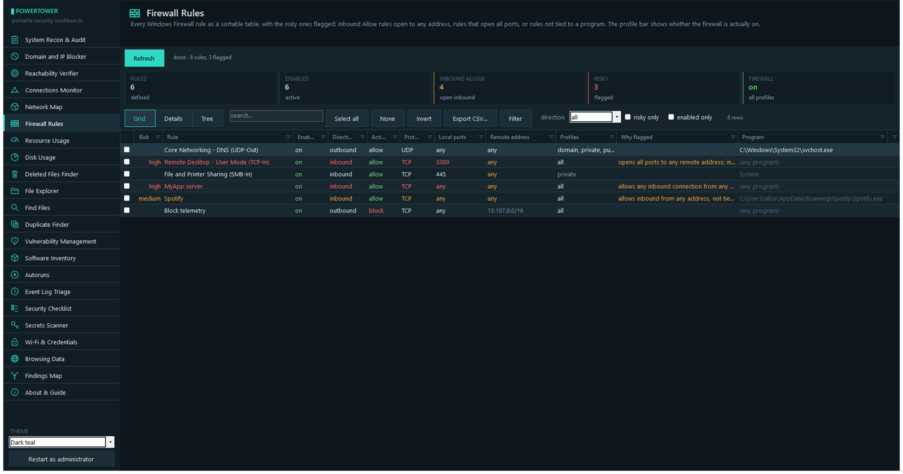

Every Windows Firewall rule as a sortable table, with the risky ones flagged — inbound **Allow** rules open
to **any** remote address, rules that open **all ports**, and rules not tied to a program (worse on the
public profile). The stat bar shows whether the firewall is actually **on** for each profile and its default
inbound action. Filter to *risky only*, a direction, or *enabled only*.

### 13 · ♻️ Duplicate Finder

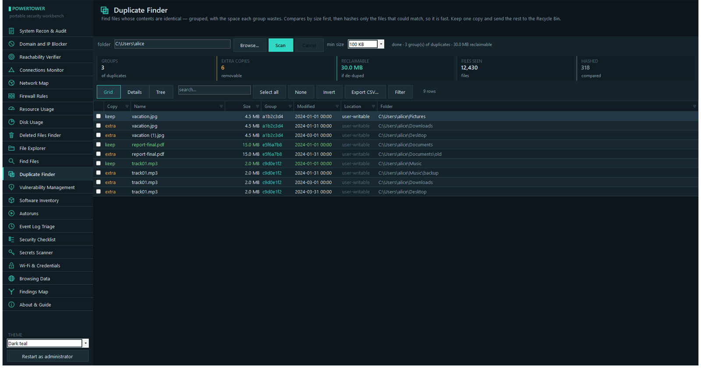

Find files whose **contents** are identical: group by size, then a partial hash, then a full SHA-256 only
where those still collide — so it is fast even on large trees. Each group shows the space it wastes; the
oldest copy is marked *keep*. *Select all but newest per group*, then send the rest to the **Recycle Bin**
(reversible).

### 14 · ▶️ Autoruns

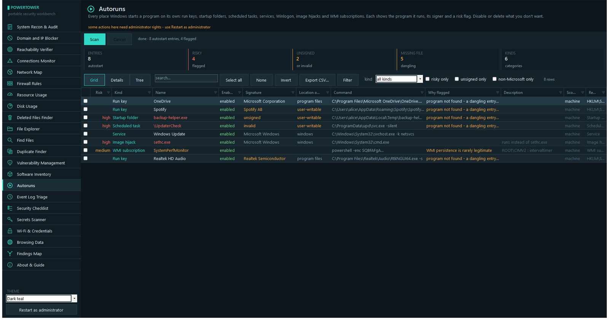

Every place Windows starts a program on its own — **run keys** and RunOnce, **startup folders**, **scheduled
tasks**, **services**, **Winlogon**, **image hijacks** (IFEO/SilentProcessExit), **AppInit DLLs**, **boot
execute**, **Active Setup** and **WMI event subscriptions** — with the program each one runs, its
**Authenticode signer** (embedded or catalog), where it lives on disk, and a **risk flag** (unsigned or
invalid in a writable folder, a dangling target, a hijack, a non-default Winlogon value). *Disable* moves an
entry aside (the Sysinternals `AutorunsDisabled` convention), *Enable* restores it, *Delete* removes it.
Needs administrator rights to change machine-wide entries.

### 15 · 📜 Event Log Triage

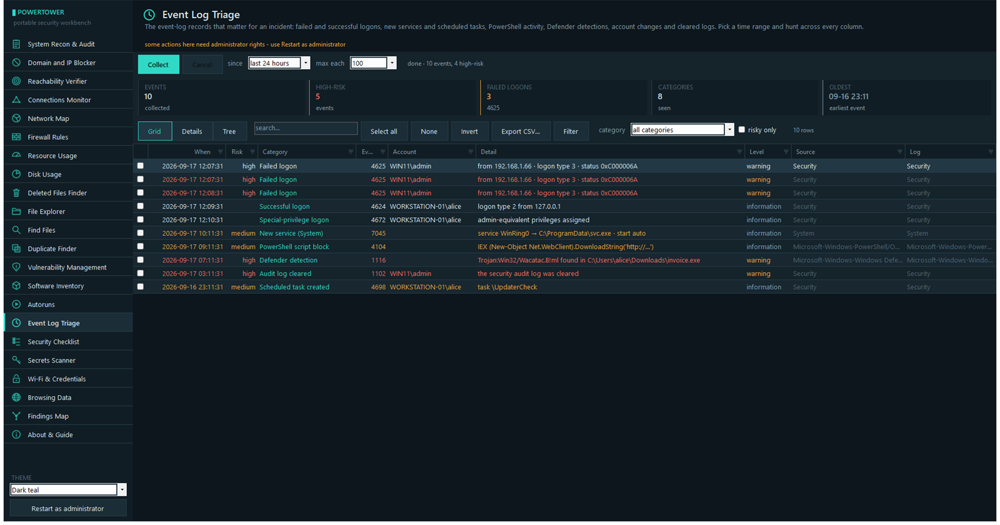

The security-relevant records from the Windows event logs over a time range: **failed and successful
logons**, explicit-credential and special-privilege logons, **account lockouts** and changes, **new
services** (7045/4697) and **scheduled tasks** (4698), **PowerShell script blocks** (4104), **Defender
detections**, **process creation** (4688) and **cleared audit logs** (1102). Each record is parsed into
account and detail fields and tinted by risk. Reading the Security log needs administrator rights.

### 16 · 🔑 Secrets Scanner

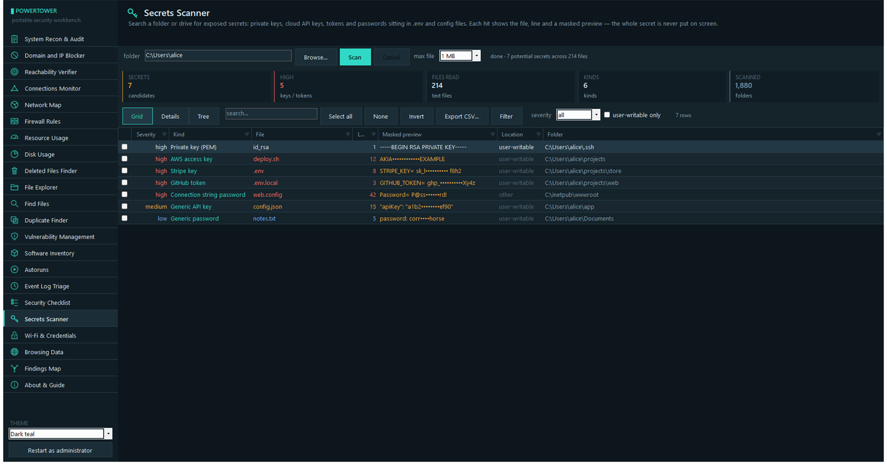

Walk a folder or drive for **exposed secrets** — private keys (PEM/PuTTY), AWS/Google/GitHub/Slack/Stripe
keys, JWTs, bearer tokens, connection-string and generic passwords — in `.env` and config files. Each hit
shows the file, line, kind and a **masked preview**; the whole secret is never put on screen. High-entropy
filtering and a placeholder skip cut the obvious false positives.

### 17 · 📶 Wi-Fi & Credentials

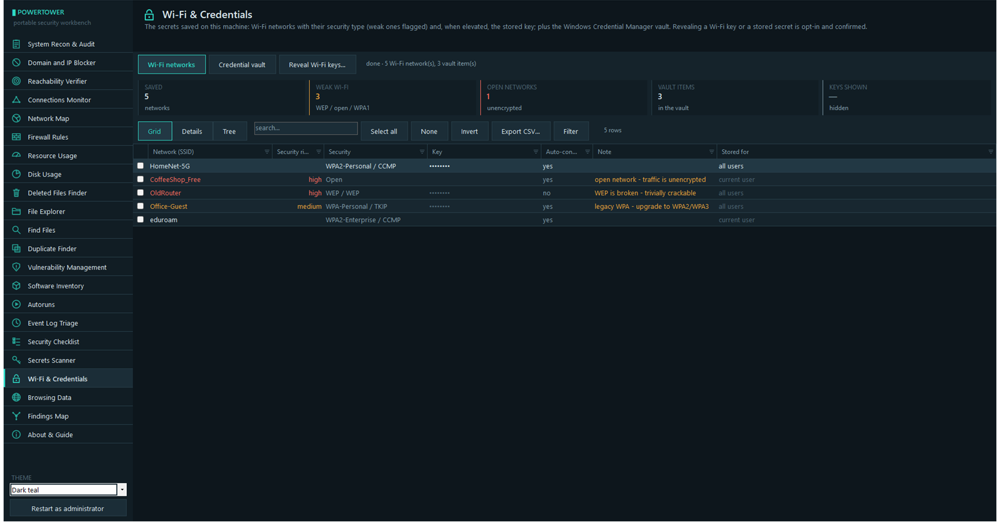

The secrets saved on this machine: **Wi-Fi profiles** with their security type — **open**, **WEP** and
legacy **WPA** are flagged — and, when elevated, the stored key; plus the **Windows Credential Manager
vault** (generic and domain credentials). Keys and secrets are hidden until you click **Reveal**, which
confirms first, since it puts a real password on screen.

### 18 · 🔏 Signatures woven in

There is no separate "signature checker" — Authenticode verification is folded into the tools that need it.
**File Explorer** shows a *Signature* column, **Resource Usage** has a *Loaded modules…* action that lists a
process's DLLs and flags the unsigned ones, and **Autoruns** verifies every autostart program.

### · 🌍 Network Map

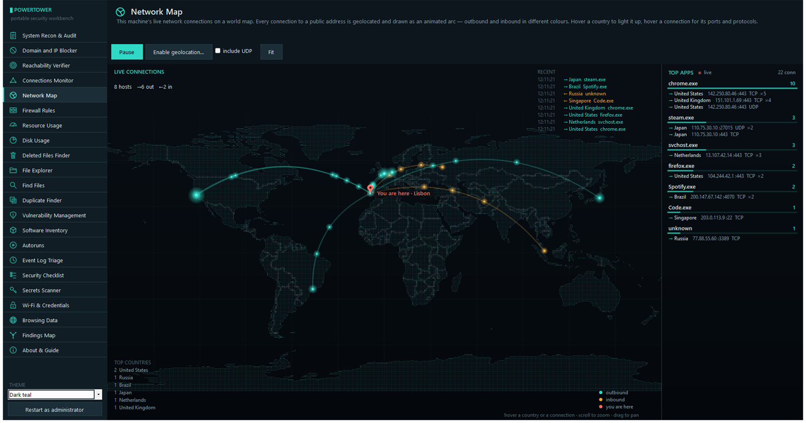

This machine's **live connections on a world map**, in the style of the big threat maps. The world is a
dense grid of small dots drawn from **real country shapes** (Natural Earth polygons rasterized and packed
into ~19 KB inside the exe — nothing is downloaded to draw it), with country **borders** picked out in
brighter dots. **Hover a country** and its whole shape lights up with its name. Every connection to a
public address is drawn as an animated **great-circle arc** from the red **"You are here"** pin to the
remote end, pulses travelling along it — **teal outbound, amber inbound**. **Hover a connection or an
endpoint** for the city, ISP, direction and the **ports, protocols and processes** behind it. A
top-countries list, live ticker and legend sit over the map; scroll to zoom, drag to pan. Placing points
needs **geolocation**, which is opt-in and confirmed: each remote IP is looked up via the free ip-api.com
service (the one place this tool uses the network) and cached to disk.

### 20 · 🌐 Browsing Data

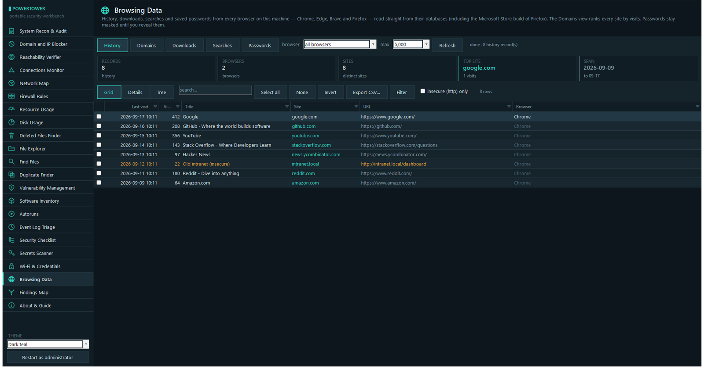

History, downloads, searches and **saved passwords** from every browser on this machine — Chrome, Edge,
Brave, Vivaldi, Opera and **Firefox** (classic and Microsoft Store builds) — read straight from their SQLite stores by a small **dependency-free
SQLite reader** written for this app (no external library). Switch between **History** (URL, title, visit
count, last visit, site), **Domains** (every unique site ranked by total visits, with page counts, a share bar, first/last seen and which browsers), **Downloads** (file, size, state, source), **Searches** and **Passwords**. The
tree view groups by site, so you can see where the time went; the cards show the record count, distinct
sites, the busiest site and the date span. Saved passwords are **masked until you click Reveal** and confirm
— exactly like the Wi-Fi reveal; Chromium passwords are decrypted locally with DPAPI + AES-256-GCM, Firefox
through the NSS library it ships. Entries protected by newer **app-bound encryption** (recent Chrome/Edge)
or a Firefox master password can't be shown and say so.

### 19 · 🕸️ Findings Map

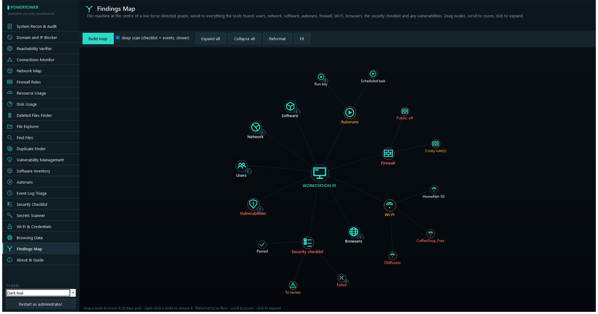

*Now a live **force-directed** graph — nodes repel, edges pull, a gentle gravity centres it, so it settles smoothly and every node can be dragged. Each node is a themed **icon** (the endpoint a monitor, Firewall a brick wall, Wi-Fi signal arcs, Vulnerabilities a shield…), tinted by severity. It captures the newer tools too: autoruns, firewall, Wi-Fi, browsers and recent events. Every node is a small flat icon in one theme colour; **drag a node and it stays where you drop it**, right-click to release it, and **Reformat** re-flows the whole map. Big groups fan out so many items stay readable.*

This machine as one node at the centre of a graph, wired to what was found: **Users**, **Network**
(addresses, listening ports, active connections), **Software**, the **Security checklist** (grouped into
failed / to review / passed) and **Vulnerabilities** (the open findings from a scan run this session).
Click a node to expand or collapse it, drag to pan, scroll to zoom, *Fit* to recentre. Nodes are coloured
by risk, so the red branches show where to look first. *Build map* gathers everything in the background
with a step strip; ticking *include security checklist* adds its findings and about twenty seconds.

---

## Command line: `PowerTowerCli.exe`

Every tool except the two maps is also a command. The names, the order, the columns and the view bar are
the app's, so knowing one teaches the other:

| in the app | on the command line |
|---|---|
| a tool in the sidebar | `PowerTowerCli <tool>` (the same names, in the same order: `PowerTowerCli` alone lists them) |
| the header: title, blurb, administrator note | printed above every result |
| the summary cards | one `KEY value` line above the table |
| Grid / Details / Tree | `--view grid` (default), `--view details`, `--view tree` (the same grouping) |
| the search box | `--search <text>` |
| clicking a column header | `--sort <column>` and `--desc` |
| Filter → a rule, chips combine with AND | `--where "<column> <operator> <value>"`, repeatable; the same 13 operators, the same unit parsing (`size at least 10 MB`) |
| ticking rows, Select all | `--select "<column> <operator> <value>"`, repeatable, or `--all` |
| the bar of actions under the rows | the tool's action flags (`--block`, `--recover-to`, `--disable`, `--encrypt`, …), applied to the ticked rows |
| Yes in a confirmation | `--yes` (asked on the console otherwise; refused when there is no console) |
| Export CSV… | `--csv <file>`, the same headers, the ticked rows or everything shown |
| the combo boxes and toggles next to the search box | the tool's filter options (`--risky`, `--severity`, `--status`, `--source`, …) |
| Restart as administrator | run from an elevated prompt; tools say when they need it |

Tables go to stdout and progress to stderr, so `PowerTowerCli firewall --risky | more` and `--csv` compose. Exit codes:
0 ok · 1 problems · 2 usage · 3 administrator needed · 4 cancelled. `settings.ini` and `cache\` are shared with the app.

```
▌ POWERTOWER
  portable security workbench · command line · administrator

usage:  PowerTowerCli <tool> [options]
        PowerTowerCli <tool> --help        options, actions and columns of one tool

Recon & network
  recon            System Recon & Audit        needs administrator for some actions
  blocker          Domain and IP Blocker       needs administrator for some actions
  reachability     Reachability Verifier       
  connections      Connections Monitor         
  network-map      Network Map                 desktop app only (visual)
  firewall         Firewall Rules              

Files & storage
  resource-usage   Resource Usage              
  disk-usage       Disk Usage                  
  deleted-files    Deleted Files Finder        needs administrator for some actions
  file-explorer    File Explorer               
  find-files       Find Files                  
  duplicates       Duplicate Finder            

Vulnerabilities & software
  vulnerabilities  Vulnerability Management    
  software         Software Inventory          

Threat hunting & incident response
  autoruns         Autoruns                    needs administrator for some actions
  events           Event Log Triage            needs administrator for some actions
  checklist        Security Checklist          needs administrator for some actions

Secrets & credentials
  secrets          Secrets Scanner             
  credentials      Wi-Fi & Credentials         
  browsing         Browsing Data               

Putting it together
  findings-map     Findings Map                desktop app only (visual)

  about            
  version          

Every tool shows rows the way the app does and takes the same view options:
  --view <grid|details|tree>    how to show the rows: the app's Grid, Details or Tree button
  --search <text>               keep the rows where any column contains this text: the search box
  --sort <column>               sort by a column (its key or title); add --desc for descending: clicking a header
  --desc                        sort descending
  --where <"column op value">   a filter rule, repeatable; rules combine with AND: the Filter bar. Column is a key, a title or 'any'; op is one of: contains,
                                does not contain, equals, does not equal, starts with, ends with, matches regex, is empty, is not empty, greater than, less
                                than, at least, at most (numbers understand KB/MB/GB, %, ms)
  --select <"column op value">  tick the rows that match, repeatable; actions and --csv then apply to the ticked rows: the row checkboxes
  --all                         let an action apply to every shown row when nothing is ticked: Select all
  --csv <file>                  write the shown rows, or the ticked ones, as CSV with the app's headers: Export CSV…
  --top <n>                     print only the first n rows (the CSV is never cut)
  --yes                         answer yes to every confirmation (required when input is not a terminal)
  --no-color                    plain output
  --width <n>                   lay the grid out for this many columns instead of the console width
  --quiet                       no progress on stderr
  --help                        help for the tool

Tables go to stdout, progress to stderr. Exit codes: 0 ok · 1 problems · 2 usage · 3 administrator needed · 4 cancelled.
```

### `recon`

```
▌ SYSTEM RECON & AUDIT
  administrator: yes
  A read-only security enumeration of this machine: system, users and groups, network, security posture,
  persistence surface, running processes and recent security events. Risky settings are flagged. Download
  the whole report as Markdown, JSON or PDF. For authorized use only.

usage:  PowerTowerCli recon [options]

options and actions
  --no-events                   skip the Security / System / PowerShell event logs (the app's 'recent
                                event logs' toggle)
  --section <name>              only this section, e.g. "3. Network" or just "3."
  --flagged                     only the facts flagged risk or review
  --md <file>                   save the report as Markdown (no value: recon_<host>_<time>.md)
  --json <file>                 save the report as JSON
  --pdf <file>                  save the report as PDF
  --log                         print the audit log and what was limited

columns of recon-audit   (tree view groups the rows)
  section · group (Category) · name (Item) · value · risk (Flag) · note

examples
  PowerTowerCli recon --flagged
  PowerTowerCli recon --section "4." --view tree
  PowerTowerCli recon --where "flag equals risk" --csv risks.csv --md
```

### `blocker`

```
▌ DOMAIN AND IP BLOCKER
  administrator: yes
  Load domains and IPs from any file or paste, review them as rows, block or unblock the ones you pick.
  Domains go to the hosts file, IPs to one firewall rule; everything is tagged, backed up and reversible.

usage:  PowerTowerCli blocker [options]

options and actions
  --file <path>                 add the domains and IPs found in this file (any text: lists, CSV, logs,
                                defanged names); repeatable
  --add <value>                 add one domain or IP; repeatable
  --stdin                       add what is piped in
  --blocked                     show what is blocked right now instead of the loaded list (the 'Blocked
                                now' button)
  --block                       block the ticked rows (or --all): domains to the hosts file, IPs to the
                                firewall rule
  --unblock                     unblock the ticked rows (or --all)
  --no-hosts                    do not touch the hosts file
  --no-firewall                 do not touch the firewall rule
  --no-www                      do not add the www. variant of each domain
  --sink <ip>                   the address blocked domains resolve to (default from settings, else
                                0.0.0.0)
  --backups                     list the hosts-file backups
  --restore <backup-file>       restore the hosts file from one of its backups
  --flush-dns                   flush the DNS cache after changing the hosts file

columns of block-list   (tree view groups the rows)
  value (Domain / IP) · kind · status · where (Blocked by) · note · line · source (Source line)
columns of blocked-now   (tree view groups the rows)
  value (Domain / IP) · kind · where (Blocked by) · note (Detail)

examples
  PowerTowerCli blocker --file samples\sample-blocklist.txt
  PowerTowerCli blocker --file threats.txt --block --all
  PowerTowerCli blocker --blocked --view tree
  PowerTowerCli blocker --blocked --select "kind equals domain" --unblock
```

### `reachability`

```
▌ REACHABILITY VERIFIER
  Pull every IP and domain out of a file or a paste and check whether this machine can reach them: DNS,
  ping, and the TCP ports you choose. Send the ones that answer straight to the blocker.

usage:  PowerTowerCli reachability [options]

options and actions
  --file <path>                 targets from this file (any text); repeatable
  --add <value>                 one domain or IP; repeatable
  --stdin                       targets piped in
  --ports <list>                TCP ports to connect to, comma-separated (default 80,443)
  --timeout <seconds>           per-attempt timeout (default 3)
  --parallel <n>                targets checked at once (default 32)
  --no-ping                     skip the ICMP ping
  --block                       send the ticked rows (or --all) to the blocker and block them

columns of reachability   (tree view groups the rows)
  target · kind · status · dns · ip (Resolves to) · ping · p80 (TCP 80) · p443 (TCP 443) ·
  source (Source line)

examples
  PowerTowerCli reachability --add example.com --add 1.1.1.1 --ports 53,443
  PowerTowerCli reachability --file targets.txt --where "status equals reachable" --csv reachable.csv
  PowerTowerCli reachability --file targets.txt --select "status equals reachable" --block
```

### `connections`

```
▌ CONNECTIONS MONITOR
  Every TCP and UDP endpoint this machine has open, live: process, ports, remote host and state. Closed
  connections linger greyed for a while. Block a remote address in two clicks.

usage:  PowerTowerCli connections [options]

options and actions
  --interval <1|2|5>            seconds between refreshes (default 1)
  --duration <seconds>          stop after this long (default: until Ctrl+C on a console, one snapshot
                                when piped)
  --once                        one snapshot
  --tcp                         TCP only
  --udp                         UDP only
  --established                 established connections only
  --listening                   listening ports only
  --other                       other states only
  --loopback                    include loopback endpoints
  --no-resolve                  do not resolve remote host names
  --no-keep                     drop closed connections at once instead of keeping them 30 s
  --process <name>              only processes whose name contains this
  --block                       after the snapshot, block the remote IPs of the ticked rows (or --all)

columns of connections   (tree view groups the rows)
  proto · proc (Process) · pid · local · lport (L.port) · remote · rport (R.port) · host (Remote host) ·
  state · first (First seen) · last (Last seen) · alive ()

examples
  PowerTowerCli connections --once
  PowerTowerCli connections --established --process chrome --duration 20
  PowerTowerCli connections --once --where "remote is not empty" --csv now.csv
```

### `firewall`

```
▌ FIREWALL RULES
  Every Windows Firewall rule as a sortable table, with the risky ones flagged: inbound Allow rules open
  to any address, rules that open all ports, or rules not tied to a program. The profile bar shows whether
  the firewall is actually on.

usage:  PowerTowerCli firewall [options]

options and actions
  --inbound                     inbound rules only
  --outbound                    outbound rules only
  --risky                       flagged rules only
  --enabled                     enabled rules only

columns of firewall-rules   (tree view groups the rows)
  risk · name (Rule) · on (Enabled) · dir (Direction) · act (Action) · proto (Protocol) ·
  lports (Local ports) · remote (Remote address) · profiles · why (Why flagged) · prog (Program) · group

examples
  PowerTowerCli firewall --risky
  PowerTowerCli firewall --inbound --enabled --where "action equals allow" --sort name
```

### `resource-usage`

```
▌ RESOURCE USAGE
  Which processes have used the most CPU time, memory and disk I/O since you opened this, not just right
  now. Exited processes stay in the table, greyed, because their totals still count.

usage:  PowerTowerCli resource-usage [options]

options and actions
  --interval <1|2|5>            seconds between samples (default 1)
  --duration <seconds>          stop after this long (default: until Ctrl+C on a console, one sample when
                                piped)
  --once                        one sample (two readings a second apart)
  --by-pid                      one row per process instead of grouping by name
  --modules <pid>               list the DLLs loaded in one process with their signatures (Loaded
                                modules…)
  --end                         end the ticked processes (or --all): a kill, nothing is saved

columns of process-hogs   (tree view groups the rows)
  name (Process) · pid · cpu (CPU %) · cput (CPU time) · share · trend · mem (Memory) · peak ·
  ior (Disk read) · iow (Disk write) · ion (I/O now) · state ()
columns of modules-process   (tree view groups the rows)
  name (Module) · sig (Signature) · where (Location) · company · path

examples
  PowerTowerCli resource-usage --once --top 15
  PowerTowerCli resource-usage --by-pid --duration 30 --sort mem --desc
  PowerTowerCli resource-usage --modules 4312
```

### `disk-usage`

```
▌ DISK USAGE
  Scan a drive or a folder and see where the space went: the folder tree with sizes, the largest files,
  the biggest folders, and what kinds of files they are. Open, copy or send the ones you pick to the
  Recycle Bin.

usage:  PowerTowerCli disk-usage [options]

options and actions
  --path <drive-or-folder>      what to scan (default: the first fixed drive)
  --min-mb <n>                  only files at least this big are kept in the largest-files list (default
                                50)
  --show <files|folders|types>  largest files, folders, or file types (default files)
  --recycle                     move the ticked rows (or --all) to the Recycle Bin

columns of storage-largest-files   (tree view groups the rows)
  name (File) · size · share (Of parent) · ext (Type) · mod (Modified) · path
columns of storage-folders   (tree view groups the rows)
  name (Folder) · size · share (Of parent) · files · subs (Folders) · depth · mod (Modified) · path
columns of storage-file-types   (tree view groups the rows)
  ext (Type) · bytes (Total size) · share · count (Files) · avg (Average)

examples
  PowerTowerCli disk-usage --path D:\ --show folders --view tree
  PowerTowerCli disk-usage --path C:\Users --show types
  PowerTowerCli disk-usage --path C:\Temp --select "size at least 1 GB" --recycle
```

### `deleted-files`

```
▌ DELETED FILES FINDER
  administrator: yes
  What was permanently deleted on each drive and whether it can come back: the NTFS change journal for C:,
  the directory tables of exFAT externals, shadow copies, and files emptied from the Recycle Bin. Recover
  the ones you pick to another drive.

usage:  PowerTowerCli deleted-files [options]

options and actions
  --drives <letters>            drives to scan, e.g. C,E (default: every NTFS and exFAT drive)
  --days <n>                    how far back (default 30)
  --under <path>                only entries under this folder
  --type <list>                 only these extensions, e.g. jpg,png,docx
  --name <text>                 only names containing this
  --min <n>                     minimum size in --unit (exFAT only; the journal records no size)
  --max <n>                     maximum size in --unit
  --unit <KB|MB|GB>             the unit of --min and --max (default MB)
  --noise                       include temp files, caches and other noise
  --no-shadows                  do not look for copies in shadow copies
  --source <all|journal|exfat>  which source to show (default all)
  --recoverable                 recoverable entries only
  --recover-to <folder>         copy the ticked recoverable files (or --all) into this folder, on another
                                drive

columns of deleted-files   (tree view groups the rows)
  when · type · rec (Recoverable) · path · size · state (Data) · source · note · times (×) ·
  shadow (Shadow source) · recto (Recovered to)

examples
  PowerTowerCli deleted-files --days 7
  PowerTowerCli deleted-files --drives E --type jpg,mp4 --recoverable
  PowerTowerCli deleted-files --drives E --select "recoverable equals yes" --recover-to D:\recovered
```

### `file-explorer`

```
▌ FILE EXPLORER
  Browse the machine, pick files across folders, and act on the whole selection at once: encrypt them with
  a password, decrypt them back, or destroy them for good with a permanent delete or a secure wipe.
  Encryption is AES-256; a lost password cannot be recovered.

usage:  PowerTowerCli file-explorer [options]

options and actions
  --path <folder>               the folder to list (default: your profile)
  --hidden                      show hidden and system entries
  --encrypt                     encrypt the ticked files with a password to .enc and delete the originals
  --decrypt                     decrypt the ticked .enc files next to themselves
  --password <text>             the password for --encrypt / --decrypt (asked for when omitted)
  --delete                      permanently delete the ticked entries (bypasses the Recycle Bin)
  --wipe                        overwrite the ticked entries with random data, then delete them
  --new-folder <name>           create a folder here first

columns of folder   (tree view groups the rows)
  name · type · size · mod (Modified) · sig (Signature) · attr (Attributes) · path

examples
  PowerTowerCli file-explorer --path C:\Users\alice\Documents
  PowerTowerCli file-explorer --path .\drafts --select "type equals docx" --encrypt
  PowerTowerCli file-explorer --path .\drafts --select "name ends with .enc" --decrypt
```

### `find-files`

```
▌ FIND FILES
  Find files anywhere on the machine. By name: type a full or partial name, or a *.ext wildcard, and it
  streams matches as it walks the drives. By hash: paste one or more MD5, SHA-1 or SHA-256 hashes and it
  reports every file that matches, with a size cap so it stays fast.

usage:  PowerTowerCli find-files [options]

options and actions
  --name <pattern>              search by name: a full or partial name, or a *.ext wildcard
  --hash <hashes>               search by hash: MD5, SHA-1 or SHA-256, several separated by spaces;
                                repeatable
  --hash-file <path>            read hashes out of any text file (lists, CSV, IOC reports)
  --in <root>                   where to search; repeatable (default: every fixed drive)
  --match-case                  case-sensitive name match
  --max-mb <n>                  skip files bigger than this when hashing (default 100)
  --include-windows             hash inside the Windows folder too

columns of find-by-name   (tree view groups the rows)
  name · size · mod (Modified) · type · dir (Folder)
columns of find-by-hash   (tree view groups the rows)
  name (File) · algo (Algorithm) · hash (Matched hash) · size · mod (Modified) · path

examples
  PowerTowerCli find-files --name *.pfx
  PowerTowerCli find-files --name invoice --in C:\Users --match-case
  PowerTowerCli find-files --hash-file iocs.txt --in D:\ --csv hits.csv
```

### `duplicates`

```
▌ DUPLICATE FINDER
  Find files whose contents are identical — grouped, with the space each group wastes. Compares by size
  first, then hashes only the files that could match, so it is fast. Keep one copy and send the rest to
  the Recycle Bin.

usage:  PowerTowerCli duplicates [options]

options and actions
  --path <folder>               the folder to scan (default: your profile)
  --min <size>                  ignore files smaller than this, e.g. 1KB, 100KB, 1MB, 10MB (default 100KB)
  --recycle                     send the ticked files (or --all) to the Recycle Bin
  --recycle-extras              send every extra copy to the Recycle Bin, keeping the oldest of each group

columns of duplicates   (tree view groups the rows)
  keep (Copy) · name · size · group · mod (Modified) · where (Location) · dir (Folder)

examples
  PowerTowerCli duplicates --path D:\Photos --min 1MB
  PowerTowerCli duplicates --path D:\Photos --view tree
  PowerTowerCli duplicates --path D:\Photos --recycle-extras
```

### `vulnerabilities`

```
▌ VULNERABILITY MANAGEMENT
  Which CVEs this machine is exposed to and why: the OS build and installed hotfixes against Microsoft's
  monthly security releases, installed software against the NVD, and what Windows Update is offering right
  now. CISA's known-exploited list and EPSS rank the findings; every one shows its evidence.

usage:  PowerTowerCli vulnerabilities [options]

options and actions
  --show <findings|missing|software|hotfixes>                                         which table (default
                                                                                      findings)
  --no-wua                                                                            skip Windows Update
  --no-msrc                                                                           skip Microsoft's
                                                                                      monthly CVEs
  --no-nvd                                                                            skip third-party
                                                                                      software (NVD)
  --no-kev                                                                            skip CISA KEV
  --no-epss                                                                           skip EPSS
  --months <n>                                                                        monthly MSRC
                                                                                      releases to check,
                                                                                      newest first
                                                                                      (default from
                                                                                      settings, else 3)
  --nvd-key <key>                                                                     an NVD API key
                                                                                      (saved to
                                                                                      settings.ini like
                                                                                      the app does)
  --severity <critical|high|medium>                                                   findings at least
                                                                                      this severe
  --status <open|all|vulnerable|update available|reboot pending|patched|unconfirmed>  finding status
                                                                                      (default open)
  --source <MSRC|NVD|Windows Update>                                                  finding source
  --exploited                                                                         known-exploited
                                                                                      findings only
  --feeds                                                                             list the cached feed
                                                                                      files and stop
  --clear-feeds                                                                       delete the cached
                                                                                      feeds and stop
  --log                                                                               print the scan log

columns of vulnerability-findings   (tree view groups the rows)
  cve · sev (Severity) · cvss · kev (Exploited) · epss · status · product · inst (Installed) · fix ·
  src (Source) · title · ev (Evidence) · rel (Release) · due (KEV due)
columns of missing-updates   (tree view groups the rows)
  kb · title · sev (Severity) · kind · cves · dl (Downloaded) · size · pub (Published) · reboot ·
  cat (Categories)
columns of installed-software   (tree view groups the rows)
  name (Program) · ver (Version) · cves · cpe (NVD product) · status · pub (Publisher) · inst (Installed) ·
  scope
columns of hotfixes   (tree view groups the rows)
  kb · src (Source) · when (Installed on) · result · desc (Description) · title

examples
  PowerTowerCli vulnerabilities 
  PowerTowerCli vulnerabilities --show software --where "cves greater than 0"
  PowerTowerCli vulnerabilities --status all --source MSRC --csv msrc.csv
  PowerTowerCli vulnerabilities --no-wua --no-nvd --months 6 --exploited
```

### `software`

```
▌ SOFTWARE INVENTORY
  Every program installed on this machine and its version. Scan for CVEs to flag the vulnerable ones with
  their severity, worst CVE, whether it is known-exploited, and the version to upgrade to. Filter by
  anything — vulnerable only, severity, publisher, or any column.

usage:  PowerTowerCli software [options]

options and actions
  --scan                             look the mapped programs up on the NVD and flag the vulnerable ones
  --nvd-key <key>                    an NVD API key (saved to settings.ini)
  --no-kev                           skip CISA KEV
  --no-epss                          skip EPSS
  --severity <critical|high|medium>  programs whose worst CVE is at least this severe
  --vulnerable                       vulnerable programs only
  --exploited                        known-exploited only
  --mapped                           only programs in the CVE product map

columns of software-inventory   (tree view groups the rows)
  name (Program) · ver (Version) · state (Vulnerable) · sev (Severity) · cvss · cves · worst (Worst CVE) ·
  expl (Exploited) · epss · fix · pub (Publisher) · inst (Installed) · scope · cpe (NVD product) · status

examples
  PowerTowerCli software 
  PowerTowerCli software --scan --vulnerable
  PowerTowerCli software --scan --select "vulnerable equals vulnerable" --csv vulnerable.csv
```

### `autoruns`

```
▌ AUTORUNS
  administrator: yes
  Every place Windows starts a program on its own: run keys, startup folders, scheduled tasks, services,
  Winlogon, image hijacks and WMI subscriptions. Each shows the program it runs, its signer and a risk
  flag. Disable or delete what you don't want.

usage:  PowerTowerCli autoruns [options]

options and actions
  --kind <name>                 one kind only, e.g. "Run key", "Scheduled task", Service
  --risky                       flagged entries only
  --unsigned                    unsigned or invalid signatures only
  --non-microsoft               hide Microsoft-signed entries
  --disable                     disable the ticked entries
  --enable                      enable the ticked entries
  --delete                      delete the ticked entries for good

columns of autoruns   (tree view groups the rows)
  risk · kind · name · on (Enabled) · sig (Signature) · where (Location on disk) · cmd (Command) ·
  why (Why flagged) · desc (Description) · scope · loc (Registry / path)

examples
  PowerTowerCli autoruns --risky
  PowerTowerCli autoruns --non-microsoft --view tree
  PowerTowerCli autoruns --select "name equals backup-helper.exe" --disable
```

### `events`

```
▌ EVENT LOG TRIAGE
  administrator: yes
  The event-log records that matter for an incident: failed and successful logons, new services and
  scheduled tasks, PowerShell activity, Defender detections, account changes and cleared logs. Pick a time
  range and hunt across every column.

usage:  PowerTowerCli events [options]

options and actions
  --since <1h|24h|7d|30d>       how far back (default 24h)
  --max <50|100|250|500>        records per category (default 100)
  --category <name>             one category only
  --risky                       flagged events only

columns of events   (tree view groups the rows)
  time (When) · risk · cat (Category) · id (Event) · who (Account) · detail · level · src (Source) · log

examples
  PowerTowerCli events --since 7d --risky
  PowerTowerCli events --category "Failed logon" --view tree
  PowerTowerCli events --since 30d --csv events.csv
```

### `checklist`

```
▌ SECURITY CHECKLIST
  administrator: yes
  A pass or fail review of the most common endpoint audit items: default and blank-password accounts, disk
  encryption, antivirus and EDR products with their state, remote-access and VPN tools, USB control and
  the firewall. Each check shows its evidence; export the whole report as Markdown, JSON or PDF.

usage:  PowerTowerCli checklist [options]

options and actions
  --category <name>                                   one category only
  --show <everything|failures|fail|review|pass|info>  which results (default everything)
  --active                                            also run the two active tests: the EICAR file drop
                                                      and the application-control policy read (your
                                                      antivirus will react on purpose)
  --md <file>                                         save the report as Markdown
  --json <file>                                       save the report as JSON
  --pdf <file>                                        save the report as PDF
  --log                                               print the run log

columns of security-checklist   (tree view groups the rows)
  cat (Category) · name (Check) · res (Result) · detail · ev (Evidence) · q (Question)

examples
  PowerTowerCli checklist 
  PowerTowerCli checklist --show failures --view tree
  PowerTowerCli checklist --active --md --pdf
```

### `secrets`

```
▌ SECRETS SCANNER
  Search a folder or drive for exposed secrets: private keys, cloud API keys, tokens and passwords sitting
  in .env and config files. Each hit shows the file, line and a masked preview — the whole secret is never
  put on screen.

usage:  PowerTowerCli secrets [options]

options and actions
  --path <folder>               the folder to scan (default: your profile)
  --max-kb <256|1024|4096>      skip files bigger than this (default 1024)
  --severity <high|medium>      high only, or medium and up
  --writable                    hits in user-writable locations only

columns of secrets   (tree view groups the rows)
  sev (Severity) · kind · file · line · preview (Masked preview) · where (Location) · dir (Folder)

examples
  PowerTowerCli secrets --path C:\projects
  PowerTowerCli secrets --path C:\projects --severity high --csv secrets.csv
```

### `credentials`

```
▌ WI-FI & CREDENTIALS
  The secrets saved on this machine: Wi-Fi networks with their security type (weak ones flagged) and, when
  elevated, the stored key; plus the Windows Credential Manager vault. Revealing a Wi-Fi key or a stored
  secret is opt-in and confirmed.

usage:  PowerTowerCli credentials [options]

options and actions
  --show <wifi|vault>           saved Wi-Fi networks or the Credential Manager vault (default wifi)
  --reveal                      show the Wi-Fi keys / a masked preview of vault secrets (confirmed, as in
                                the app)

columns of wifi-networks   (tree view groups the rows)
  ssid (Network (SSID)) · risk (Security risk) · sec (Security) · key · auto (Auto-connect) · why (Note) ·
  scope (Stored for)
columns of credential-vault   (tree view groups the rows)
  target · user · type · secret · persist (Persistence) · when (Last written)

examples
  PowerTowerCli credentials 
  PowerTowerCli credentials --reveal --csv wifi.csv
  PowerTowerCli credentials --show vault --view tree
```

### `browsing`

```
▌ BROWSING DATA
  History, downloads, searches and saved passwords from every browser on this machine — Chrome, Edge,
  Brave and Firefox — read straight from their databases (including the Microsoft Store build of Firefox).
  The Domains view ranks every site by visits. Passwords stay masked until you reveal them.

usage:  PowerTowerCli browsing [options]

options and actions
  --show <history|domains|downloads|searches|passwords>  which table (default history)
  --browser <label>                                      one browser profile whose label contains this,
                                                         e.g. Chrome, Edge, Firefox
  --max <1000|5000|20000|all>                            history rows per profile (default 5000)
  --insecure                                             http (not https) rows only
  --reveal                                               decrypt and show the saved passwords (confirmed,
                                                         as in the app)

columns of browsing-history   (tree view groups the rows)
  when (Last visit) · visits · title · domain (Site) · url · browser
columns of browsing-domains   (tree view groups the rows)
  rank (#) · domain (Site) · visits · pages · bar (Share) · last (Last visit) · first (First visit) ·
  browsers
columns of browsing-downloads   (tree view groups the rows)
  when · file · size · state · domain (From site) · url (Source URL) · path (Saved to) · browser
columns of browsing-searches   (tree view groups the rows)
  when · term (Search term) · domain (Engine / site) · url · browser
columns of browsing-passwords   (tree view groups the rows)
  site · user (Username) · pass (Password) · weak · when (Saved) · note · url · browser

examples
  PowerTowerCli browsing --show domains --top 25
  PowerTowerCli browsing --show downloads --browser Edge
  PowerTowerCli browsing --show passwords --reveal --csv logins.csv
```

## Files

```
Toolbox\PowerTower.exe        the desktop app
Toolbox\PowerTowerCli.exe     the same tools on the command line (PowerTowerCli <tool> --help)
Toolbox\Program.cs            entry point of the app; flags --tool <PanelName>, --selftest <report.txt>, --shots <folder>
Toolbox\Ui.cs                 theme, DataView (grid / details / tree, filter rules), step strip, selection bar, shell
Toolbox\Table.cs              the UI-free view kit both exes share: Col, FilterRule, Csv, Settings, tones, the tool registry
Toolbox\Columns.cs            every table of every tool, defined once (columns, tree grouping, row tone, export name)
Toolbox\Cli.cs                the command line: argument parsing, the console grid / details / tree, --where / --select / --csv
Toolbox\CliTools.cs           one command per tool, mirroring its panel's controls and actions
Toolbox\samples\              sample input files (a block list, a list of domains and IPs) for the blocker and the verifier
Toolbox\Panels.cs             blocker, reachability, connections, resource usage, disk usage, deleted files
Toolbox\ReconPanel.cs         System Recon & Audit
Toolbox\FilesPanel.cs         File Explorer and Find Files
Toolbox\VulnPanel.cs          Vulnerability Management
Toolbox\SoftwarePanel.cs      Software Inventory
Toolbox\ChecklistPanel.cs     Security Checklist (and the EICAR / execution active tests)
Toolbox\FirewallPanel.cs      Firewall Rules      (engine: Firewall.cs -> WinFirewall)
Toolbox\DupesPanel.cs         Duplicate Finder    (engine: Dupes.cs)
Toolbox\AutorunsPanel.cs      Autoruns            (engine: Autoruns.cs)
Toolbox\EventsPanel.cs        Event Log Triage    (engine: Events.cs -> EventHunt)
Toolbox\SecretsPanel.cs       Secrets Scanner     (engine: Secrets.cs)
Toolbox\CredsPanel.cs         Wi-Fi & Credentials (engine: Creds.cs)
Toolbox\ModuleViewer.cs       Loaded-modules window (Resource Usage)
Toolbox\AboutPanel.cs         About & Guide
Toolbox\Trust.cs             Authenticode / catalog signatures, loaded modules, image-path parsing
Toolbox\BrowserPanel.cs       Browsing Data (engines: Sqlite.cs, Browser.cs, BrowserCreds.cs)
Toolbox\MapPanel.cs           Findings Map (the graph control and its collectors)
Toolbox\Net.cs                extractor, hosts file, firewall rule, reachability, connection tables
Toolbox\Sys.cs                process sampling, storage scan, change journal, exFAT reader, shadow copies
Toolbox\Recon.cs              recon collectors, JSON reader shared, the minimal PDF writer, the report
Toolbox\Vuln.cs               inventory, JSON reader, feeds (MSRC, NVD, KEV, EPSS), resolvers, the scan
Toolbox\Files.cs              parallel file walker, AES file crypto, secure wipe, name/hash search
Toolbox\Checklist.cs          the hardening checks and their report
Toolbox\Tests.cs              engine tests (Tests.exe; exit code = failures)
Toolbox\build.cmd             rebuilds the three exes with the C# compiler that ships in Windows
Toolbox\crash.log             written only if something ever throws in the UI; the app stays open
Toolbox\app.manifest          asInvoker + per-monitor DPI; embedded at build time
Toolbox\settings.ini          created on first run: window size, last choices, NVD key (delete to reset); shared with the command line
Toolbox\cache\                downloaded vulnerability feeds, shared with the command line (safe to delete)
```

## Rebuild after changing a `.cs` file

Double-click `build.cmd`, or from a prompt in this folder:

```
build.cmd
Tests.exe
```

It uses `%WINDIR%\Microsoft.NET\Framework64\v4.0.30319\csc.exe` (C# 5, .NET Framework 4.8); no SDK
or Visual Studio needed, and it builds all three: `PowerTower.exe`, `PowerTowerCli.exe` and `Tests.exe`.
`Tests.exe` runs the engine tests without the UI; the ones that touch the
machine are read-only (hosts-file edits happen on a temporary copy, the exFAT scan is capped, the
feed tests are skipped offline). `PowerTower.exe --selftest report.txt` exercises every panel
in the real UI - it loads real data into each tool, then switches every mode and view, sorts every
column both ways, searches, applies and clears filter rules, selects and exports CSV - and writes a
report; `--shots folder` saves a screenshot of each panel. If anything ever throws inside the UI,
the app logs it to `crash.log` next to the exe and stays open instead of closing.
